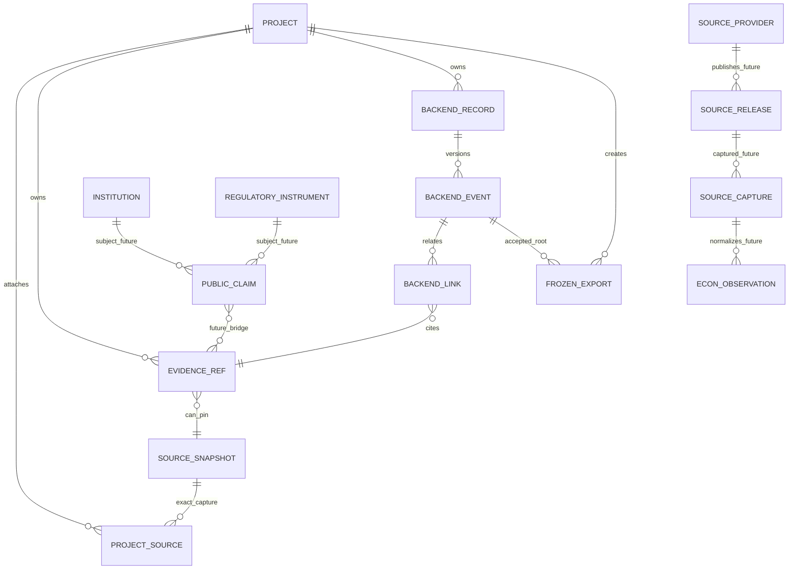

# EROS — Canonical End-Product Architecture and Controlled Implementation Strategy: Owner-Review Candidate

**Stage 2 | 23 October 2026 | MASTER END-PRODUCT ARCHITECTURE**  
**Authority:** Independent CTO / CPO / architecture / engineering evidence review; **read-only analysis, no implementation authorization**.  
**Disposition:** **CANDIDATE CANONICAL ARCHITECTURE — RECOMMENDED FOR OWNER REVIEW, NOT APPROVED**.  
**Engineering qualification:** **NOT VERIFIED** for the final local-backend-r2 release; accepted L4 baseline remains distinct.  
**Operating policy:** Public/archived/synthetic personal research; external provider activation, employer records, institution deployment, live acquisition, migrations, installations, tests and code changes are outside this commission.

## How to read the evidence (normative for this report)

This is a **target architecture recommendation**, not a statement that the target has been implemented. Evidence classes: **[PDV]** primary document directly read; **[SCV]** archive source code/SQL directly read; **[TAO]** existing test source or retained test artifact observed, no test executed; **[OAD]** owner acceptance documented, only within stated scope; **[IBU]** implemented code not owner accepted; **[PROP]** proposed design; **[INF]** architectural inference; **[UNV]** unavailable/unverified. Distinguish **source existence, reachable API, retained test result, operating authority, owner release acceptance**, each independently. A specification-level recommendation is tagged **[REC]**.

Citation convention: **OG** = `Ethiopia Research Strategy OS.zip`, whose member paths begin `Ethiopia Research Strategy OS/`; **RC** = `repeat-candidate-r2.zip` (root-relative paths); **UX** = `EROS_v1_1_UI_UX_Design_Study.zip`, members begin `EROS_v1_1_UI_UX_Design_Study/`. `!` denotes a nested ZIP member. Section headings and route names supplement member paths. Source keys below are reusable evidence references, not claims of URLs or present institutional consent.

| ID | Primary archive-relative source, exact member/path | Evidentiary scope |
|---|---|---|
| **P01** | OG:`10_Blueprints/Archives/Ethiopia_Research_Strategy_OS_Blueprint_Review_Package_v1_1.zip!01_Blueprint_v1_0.docx` | §§00–15, 15-module list §04, jobs §02, PSS boundary §10.3; original **design review baseline** [PDV] |
| **P02** | OG:`10_Blueprints/Archives/Ethiopia_Research_Strategy_OS_Blueprint_Review_Package_v1_1.zip!02_Blueprint_Completion_Addendum_v1_1.docx` | Research/manager/graph/ML/workflow completeness and unresolved owner decisions [PDV] |
| **P03** | OG:`30_Approved_Architecture/Archives/EROS_Option_C_Engineering_Package_v1_0.zip!EROS_Option_C_Implementation_Architecture_v1_0.docx` | Approved **architecture direction**, planned system, R01–R07 model and boundary; §§1–12 [PDV] |
| **P04** | OG:`30_Approved_Architecture/Reference/reference_schema.sql`; OG:`30_Approved_Architecture/Reference/api_contract_draft.yaml` | **Reference-only** Option C contract/schema, not executed migrations or running routes [PDV] |
| **P05** | OG:`00_START_HERE/L4_RESEARCH_BROWSER_STATUS_2026-10-21.md`; OG:`00_START_HERE/L5_SOURCE_REVIEW_CANDIDATE_STATUS_2026-10-21.md`; OG:`00_START_HERE/PROJECT_INDEX.md` | Historical L4 owner-accepted personal milestone; L5 conditional history [PDV/OAD] |
| **P06** | OG:`EROS_Option_C_G9_D1_D2_Approved_v0_9_1.zip!06_D1_D2_OWNER_DECISION_RECORD.md`; `!03_STAGING_GATES_AND_RUNBOOK.md` | D1/D2 bounded governance approval; D3 provisioning HOLD [PDV/OAD] |
| **P07** | RC:`package.json`; `docs/LOCAL_BACKEND_AUTHORIZATION.md`; `docs/LOCAL_BACKEND_COVERAGE.md` | Candidate identity, authorization, reported test counts (not independent execution) [PDV/TAO] |
| **P08** | RC:`docs/LOCAL_BACKEND_CONTRACT.md`; `docs/UI_UX_BACKEND_HANDOFF_r2.md`; `docs/L4_ROUTE_INVENTORY.csv` | Candidate route, DTO, lifecycle and UX corrective contract [PDV] |
| **P09** | RC:`src/l4_personal_browser.mjs`; `src/local_backend_routes.mjs`; `src/local_backend.mjs` | Current candidate local browser envelope/routes/validation/rights/ancestry/export [SCV/IBU] |
| **P10** | RC:`postgres/006_l3_local_research.sql`; `postgres/007_l4_research_browser.sql`; `postgres/008_l5_source_review.sql`; `postgres/009_indicator_ontology.sql`; `postgres/009_alias_history.sql`; `postgres/010_local_backend.sql` | Current candidate relational storage; additive tables and triggers [SCV/IBU] |
| **P11** | RC:`src/l3_local_research.mjs`; `src/l5_wdi_review.mjs`; `src/indicator_registry.mjs`; `src/source_contracts.mjs`; `data/world_bank/SOURCE_MANIFEST.json`; `data/source_catalog/WDI_SOURCE_CATALOG.json` | Archived WDI, indicator ontology, 7/5/4 lifecycle ESM contracts (not full live service) [SCV] |
| **P12** | RC:`src/local_backup.mjs`; `bin/local-backup.mjs`; `public/l4/app.js`; `public/l4/index.html`; `public/l4/styles.css`; RC:`tests/local_backend_*.test.mjs` | Closed-store tooling, actual inherited L4 UI, existing candidate test sources [SCV/TAO] |
| **P13** | RC:`src/server.mjs`; `src/registry.mjs`; `src/g4_postgres_api.mjs`; `src/g6_oidc_gateway.mjs`; `src/g8_oidc_gateway.mjs`; `docs/G2_REGISTRIES_API.md` | Separate G-series institutional prototypes, NOT L4 mounted capabilities [SCV] |
| **P14** | UX:`01_information_architecture/01_DOMAIN_MODEL_AND_HIERARCHY.md`; `01_information_architecture/02_MODULE_SCREEN_TRACEABILITY.md`; `02_navigation_and_journeys/01_NAVIGATION_MAP_AND_JOURNEYS.md` | Proposed module hierarchy, business journeys and five-part navigation [PDV/PROP] |
| **P15** | UX:`03_screen_inventory/01_SCREEN_REGISTRY_AND_FIELD_DICTIONARIES.md`; `04_wireframe_specifications/02_WIREFRAME_SPECIFICATIONS_EXTENDED.md`; `09_r1_corrections/05_SCREEN_REGISTRY_CORRECTIONS_r1.md`; `09_r1_corrections/06_PROTOTYPE_PLAN_PHASE1_r1.md` | S-00–S-22, W-23, corrections, bounded eight-screen static prototype concept [PDV/PROP] |
| **P16** | UX:`10_Codex_API_Contract_Verification/05_CAPABILITY_AND_NAVIGATION_RECONCILIATION.md`; `10_Codex_API_Contract_Verification/08_OWNER_DECISION_AND_GATE_RECOMMENDATION.md`; `EROS_UIUX_Independent_Owner_Review_2026-10-22.md` | Conflicting IA and readiness claims, corrections, recommendations **not approvals** [PDV] |
| **P17** | RC:`docs/C1_R2_ENGINEERING.md`; `docs/C1_R3_ENGINEERING.md`; `docs/C1_R2_Edge_Acceptance.json`; `docs/L4_Edge_Acceptance.json` | C1 lineage assertions and prior retained Edge evidence, not clean-r2 evidence [PDV/TAO] |
| **P18** | `EROS_Three_Package_Primary_Source_Examination_2026-10-23.md` (Stage 1 report); its three accompanying JSON inventory files | Prior verified extraction, CRC/hash/lineage baseline; secondary **audit synthesis** of P01–P17, not substitute for source [TAO] |

**Read-only research method:** Stage 1 performed all initial ZIP/CRC/digest analysis. For Stage 2, directly read original nested blueprint/Option C DOCX text, UX design/corrections, and RC source, migrations and contractual documentation from the same attached archives. No app/test/migration/connector commands executed; no provider access or credentials inspected. Note: XML text extraction may not preserve exact original document pagination/visual layout; cited headings, route names and source paths are more reliable than page numbers. Stage 1's archive SHA is retained, not re-presented as new qualification proof.

---

# 1. Executive architecture decision brief

**Decision question:** What EROS *should be* and what can be prudently constructed from the code that actually exists, without treating the accepted L4 browser as the whole product or importing a PSS/CAD/Enawuga/Model 6 platform? **[P01–P03, P05, P08–P10]**

**Recommendation [REC]:** Preserve **EROS as an Ethiopia-first evidence-governed Research and Strategy Operating System** with 15 bounded domain modules, six user-facing navigation zones (global Home plus five canonical sections), and a single **research-to-decision case record** linking archived sources, indicator observations, typed evidence, authored analysis, local review, management proposals, decisions, execution outcomes and frozen attributed briefs. Build the first **integrated management-relevant vertical slice** on the isolated personal L4 + candidate r2 backend envelope, subject to a separate engineering authorization; do **not** first build 23 isolated pages, a live connector framework, graph database, AI co-pilot or institutional identity. **[INF/REC, P01–P03, P08–P16]**

**Architecture direction:** Local **modular monolith + relational evidence/lineage + immutable versioned events + closed offline backup** for the personal evaluation product. Maintain a provider-neutral service contract and explicit domain seams to make **institutional Postgres/workspace/identity** a later, separately controlled direction. In current code, the browser uses local PGlite-compatible persistence; G4/6/8 represent separate staging proofs. Do not claim an automatic cutover. **[P03, P09–P13]**

**First meaningful feature demonstration:** “From a historical Ethiopia indicator to a defensible management decision”: researcher selects six-series archived WDI evidence, identifies an uncertainty, writes a cited assessment and evidence-backed recommendation, obtains a recorded local review, drafts a proposed action, authors and internally reviews a decision memo, commits an action **after** decision disposition, and produces a frozen Markdown executive brief with rights/integrity state visible. This is a **proposed demo/acceptance story**, not verified UI behavior. **[P08–P12, P14–P16]**

**Four immediate decisions requested, none presumed approved:** (D-01) authorize **canonical taxonomy/IA as design direction only**; (D-02) choose this integrated vertical slice rather than static eight-screen-only or 23-screen build; (D-03) approve **candidate local stack for further qualification** without accepting r2 release; (D-04) keep live provider, institutional, PSS data, AI and deployment gates on HOLD. Detail in §15.

**Truth table:**

| Dimension | Determination |
|---|---|
| Original complete product vision | 15-module blueprint [PDV], not delivered product |
| Option C | Approved architecture direction [OAD]; not implementation/deployment authorization |
| L4 | Accepted *local personal Research Browser* milestone [OAD] |
| G9 | D1/D2 accepted scope/security boundaries only; D3 HOLD [OAD] |
| C1-r3 | Separate contract-integrity candidate; not accepted |
| local-backend-r2 | Newest identifiable attached local-backend candidate [SCV/IBU]; exact final source commit and clean acceptance unverified |
| UI M01–M15 / S-00–S-22 / W-23 | Design reference and corrections [PROP], not operational coverage |
| Future data/AI/institutional functions | Design extension boundaries [REC], access and implementation unapproved |

**Go/no-go:** **GO for owner review of the architecture candidate**; **NO GO for release promotion, build authority, rollout, live acquisition, institutional claims or licensing assertions**. Release uncertainty does not prevent a clearly labelled candidate design, but it does prevent treating the unqualified bytes as an accepted development baseline. **[P05–P08, P16–P18]**

# 2. Verified authority hierarchy and taxonomy reconciliation

## 2.1 Authority precedence

**Layer A — owner-declared boundaries:** Original blueprint's independent personal ownership, source-lawful/privacy conditions and non-goals; separately documented Option C architecture direction and G9 D1/D2 authorization. **[P01 §§00–02, 10.3, 15; P03 introductory decision and §6; P06]**

**Layer B — observed implementation:** Source-verified G/L/C1/r2 features; bounded accepted L4 milestone. Implementation may supersede a proposed earlier **interface mapping**, but **may not retroactively approve scope or erase governance**. **[P05, P07–P13]**

**Layer C — design:** UI/UX is a proposal from October 22; RC October 23 handoff corrects the *candidate endpoint mapping* and does **not** authorize the UI. A contradiction is recorded, not resolved by selecting the most enthusiastic document. **[P08, P14–P16]**

**Layer D — future/secondary:** Independent roadmap and connector intelligence work; no current implementation evidence, no external use rights. **[P01, P02, P11]**

## 2.2 Namespaces that must never be flattened

| Namespace | Exact meaning | Canonical handling / collision prevention |
|---|---|---|
| **M01–M15** | Original product **module domains**; names in §3 | Stable product capability IDs, regardless of screens/backends [P01 §04] |
| **R01–R07** | Option C **institutional assurance/evidence register families** | Preserve registry namespace `governance_registry_type`, normally public/synthetic initially [P03 §4] |
| **G2 R01–R07** | Seven **prototype public research registry types** in separate G-series app | Map to Option C semantics but no institutional approval, no automatic r2/L4 route [P13] |
| **R0–R7** | Eight sequential **research lifecycle stages**, from issue to learning | Workflow `research_stage`, not table IDs or review states [P01 §§08–10] |
| **r2 eight record kinds** | `issue,question,research,action,decision,criterion,portfolio,rights` | `backend_records.kind`; cross-cutting personal workflow entities [P08–P10] |
| **S-00–S-22** | Original UI **23 registered screen identifiers** | Screens/patterns, not equivalent to modules or release commitments [P15] |
| **W-23** | Design **wireframe** for Lineage Projection View, also labelled S-23 in design tables | Mark `W-23 proposed`, **outside the original 23-screen canonical registry** until owner ratification [P15] |
| **G1–G9** | Staged Option C engineering/security/provider qualification increments | Bounded proofs, some isolated from local browser [P05, P06, P13] |
| **L1–L5** | Personal research/indicator/browser/source-review increments | Accepted L4, later L5 separately classified [P05, P11–P12] |
| **C1-r2 / C1-r3** | Contract/ontology-integrity modernization candidates | Do not conflate with `local-backend-r2` [P07, P17] |
| **local-backend-r1/r2** | Integrated research-to-decision local-backend candidate lineage | r1 artifact missing; r2 attached; owner acceptance absent [P07–P10] |
| **R1–R6 (roadmap)** | Engineering waves in architecture proposals | Not R01–R07 institutional registers nor R0–R7 research stages [P03] |

## 2.3 R01–R07 and the PSS provenance question

The blueprint expressly permits **a personal research study of a PSS-related concept** while excluding regulated PSS integration and employer records absent written authorization. It calls PSS **a use case, not the platform owner**. Option C then **intentionally adds** Buyer, Product, Systems, Licence, Scheme, Privacy, and Cyber governance/evidence domains and simultaneously prohibits copying restricted PSS inventories, licensing artifacts or sensitive records into the personal system. **This is documented intentional incorporation of governance *concepts* in the Option C design, not evidence of PSS adoption or direct migration of a PSS production register.** Exact earlier provenance of each taxonomy label from a separate PSS source system is **UNVERIFIED**: these packages alone do not trace an origin commit/dossier or grant PSS authority. **[P01 §01, §02, §10.3; P03 §1, §4, §6]**

**Disposition [REC]:** Preserve the seven types as optional **generic evidence/assurance assessments** that may be applied to any researched opportunity (e.g., who the buyer is, product maturity, integration dependencies, purported licensing permission, scheme status, lawful data use, cybersecurity risk). Change application labels to **“Public research assessment — not institutional clearance”** in personal mode. Never imply that absence of a licence assertion means no licence, that public information confers operating authority, or that a researcher can self-certify privacy/cyber controls. In any future organizational edition, each registry must be tenant-isolated and scoped to explicit institutional authority. **[P03 §4, §6; P13]**

**EROS project firewall:** EROS is a generic Ethiopia-first professional research and decision-support product. **PSS** may be a researched example only; **CAD** may be an externally governed research method/dataset **if separately introduced with provenance and rights**, not an intrinsic scoring module; **Enawuga** may be an independent business-case subject, not an embedded financing engine; **Model 6** may be separately assessed technology/evidence infrastructure, not EROS's backend or legal identity. There is no claim that such cross-project integration is implemented or authorized. **[P01 §01/§10.3; P03 §6; REC]**

## 2.4 Research lifecycle vs revision lifecycle

| Research stage, original | User deliverable | Proposed object representation | Distinguish from versioned API transitions |
|---|---|---|---|
| R0 — issue identification | Observed problem, source anomaly, intelligence trigger | `issue`, evidence reference | issue `open→investigation/hold/resolved` is not R0 completion |
| R1 — research design | Question, scope, protocol | `question` + project and notes | question `draft/active/returned/closed` is its state, not research stage |
| R2 — market/competitor diagnosis | Economic/market picture and counterevidence | `research` plus source/indicator evidence | research `draft/submitted/accepted` is a **review state**, not R2 |
| R3 — customer/problem discovery | Demand hypotheses, authorized interviews | Research revisions, future dossier | Public prospect ≠ verified buyer |
| R4 — product/model design | Options, potential product definition | Research + future M11 model | r2 portfolio is not a full financial model |
| R5 — validation/feasibility | Risks, tests, assumptions, scenario evaluation | `criterion`, `portfolio`, future scenario model | `PASS` is local criterion review, not outside validation |
| R6 — decision/pilot | Alternatives, decision, qualified action | `decision`, `action` | `accepted` local decision review ≠ approved institutional pilot |
| R7 — learning | Completion/outcome evidence, retrospective | `action.completed/outcome_verified`, follow-on research | API's `outcome_verified` remains a local assertion |

**Missing connector:** r2 records **do not contain an authoritative, enumerated `research_stage` field**. A derived stage badge is an application-level view and must not be represented as stored review status. Candidate future domain field/additive mapping requires separate authorization and migration planning. **[P01 §08; P08–P10, REC]**

---

# 3. Original product vision and capability envelope

**Mandate, paraphrased:** durable, private-by-default Ethiopia-first personal strategy environment that converts legally acquired national/peer-market economic, financial, regulatory, institutional and ecosystem signals into traceable research, opportunity/feasibility evaluations, management recommendations and defensible decisions. Expected outputs include morning briefs, current/revised indicator lineage, context-qualified peer lessons, justified product concepts, and export/recovery. Not a regulated financial execution or approval engine. **[P01 §§00–02, 04–05, 08–11, 13–15; P02 §§2–8]**

**Core capabilities, with status boundaries:**

1. **Public-source discovery/governance** — qualification, licensing, capture rights, freshness and raw/version provenance. Existing: static WDI archive and reference source metadata. Future: controlled connectors, not currently authorized. [P01 §05; P11]
2. **Evidence and knowledge** — originals, statements, support/contradiction, reviewed temporal facts and typed links. Existing: r2 snapshot/record/note/candidate evidence, event ancestry; broader entity graph and external-authenticity claims remain design. [P02–P03, P09–P10]
3. **Economic intelligence** — macro indicators, metadata, comparative historical observations, semantic units and release vintages. Existing: three archived WDI concepts, six ETH/KEN series. Future: richer official source network and economist-grade revisions. [P01 §04, §06; P11]
4. **Financial-sector and institutional intelligence** — bank/MFI/insurance/market structure, competitors, prospects, product/tariff changes. Existing: no asserted live institution-wide data layer. [P01 §§04, 07, 10; P15]
5. **Regulatory/policy and media** — instruments, draft/enacted/effective distinction, media corroboration and rights. Existing: design only as domain services; issue record is not regulation/news ingestion. [P01 §04, §07; P08]
6. **Research laboratory** — project context, methods, assumptions, claims, evidence review, uncertainty and transferability. Existing: L4 projects/notes plus r2 questions/research/events. [P01 §§02, 08; P09–P10]
7. **Product/feasibility and management decisions** — market alternatives, demand and willingness-to-pay validation, scenario economics, risk and portfolio opportunity gates. Existing: versioned criteria/portfolio/decisions, but not financial modelling. [P01 §10; P02, P08]
8. **Executive daily work** — review priorities/blocked evidence, decisions, action owners/outcomes, cited brief/exports. Existing: r2 backend objects, static/legacy home, no accepted operational cockpit. [P01 §02; P02; P08, P15]
9. **Workspace/private operations** — local session, controlled export, backup, later institutional separation. Existing: L4 local envelope and closed-store utility; separate staging OIDC/RLS proofs do not confer institutional readiness. [P03 §6; P09, P12–P13]
10. **AI assistance** — future grounded permission-aware assistance, never source authenticity or review replacement. Currently **deferred**. [P02–P03; P14]

**Non-goals:** banking ledger, transaction processing, a payment scheme platform, security certification, automatic legal advice/authority, unlicensed content republishing, institutional customer database, unreviewed AI decisions or autonomous live ingestion. **[P01 §01.3; P03 §§1, 6]**

# 4. Canonical module, navigation and experience architecture

## 4.1 Preserve all fifteen module IDs — do not confuse with screen inventory

| ID | Original authoritative module label | Canonical user expression (recommendation) | Current enabling code/UI | Delivery band |
|---|---|---|---|---|
| M01 | Source Registry & Ingestion | Sources & source quality/governance | WDI catalogue, source reviews, issue/rights APIs; no live connectors | Core partial, acquisition later |
| M02 | Evidence & Knowledge Core | Evidence and Lineage Explorer | r2 evidence refs, record lineage, frozen manifests | Core visual integration |
| M03 | Macro Indicator Studio | **Economic Intelligence Studio** (macro substudio) | Archived WDI explorer + ontology/aliases | Core historical, advanced later |
| M04 | Financial Sector Observatory | Financial Sector Observatory | Domain proposal only; no verified sector dataset | Later |
| M05 | Policy & Regulatory Watch | Regulatory & Policy Intelligence | Generic issue/research only; no instrument register | Later |
| M06 | News & Ecosystem Radar | Media and Ecosystem Radar | Generic source issue is **not** news feed | Later |
| M07 | Competitor & Institution Intelligence | Institution and Market Intelligence | Proposal, can reuse evidence core | Later |
| M08 | Potential Customer & Partner Discovery | Public Prospect/Partner Dossiers | Proposal; authority-gated contacts | Later |
| M09 | Peer Country Lessons Lab | Peer Comparison & Transferability | ETH/KEN WDI descriptive comparison only | Later transferability |
| M10 | Research Workbench | Questions, notes, claims, review | L4 project/notes; r2 versioned question/research | First integration |
| M11 | Product, Opportunity & Feasibility | Product & Feasibility Studio | r2 criterion/portfolio, **not** cash-flow engine | Partial, modelling later |
| M12 | Decision & Execution Studio | Decision Desk, Action Register | r2 decision/action events | First integration |
| M13 | Briefing & Export Centre | Briefings & Export | Legacy Markdown; r2 frozen Markdown/manifest | First integration |
| M14 | AI Research Assistant | Controlled AI Assistance | **No operational AI** | Hold |
| M15 | Workspace, Security & Operations | Personal workspace and operations | local unlock/PGlite/closed-store backup; staged G identity isolated | Core personal, institution later |

[PDV] Original names P01 §04; [SCV] actual boundaries P08–P13; [PROP] UI P14–P16. **“Economic Intelligence Studio” is an overarching display/experience label**, not a new sixteenth module and not proof of econometric/forecasting capabilities. Financial-sector, regulatory and competitor studios remain distinguishable domains.

## 4.2 Resolve three inconsistent navigation schemes

UX initial five groups are `Evidence / Research / Decisions / Output / Platform`, with global Home. The UX r1 owner matrix incorrectly says it *preserved* `Research / Sources / Analysis / Decisions / System`; Phase-1 eight-screen plan uses `Home / Sources / Indicators / Export` as quick navigation. These are not the same hierarchy. **[P14 navigation map; P15 Phase1; P16 reconciliation §EV-05]**

**Canonical product IA [REC]:**

```text
GLOBAL (outside module hierarchy)
  Home / Intelligence Brief + active Project/Workspace selector
EVIDENCE
  Source Registry & Rights [M01] — S-02, S-03, S-05
  Evidence Library & Lineage [M02] — S-04 drawer, W-23 projection
  Economic Intelligence Studio [M03] — S-12, S-13 comparison panel
  Financial Sector Observatory [M04] — S-19 [later]
  Regulatory & Policy Intelligence [M05] — S-18 [later]
  Media & Ecosystem Radar [M06] — [later; no fake screen]
  Institution & Market Intelligence [M07] — S-20 [later]
  Prospect/Partner Discovery [M08] — S-20 shared dossier [later]
  Peer Country Lessons [M09] — S-21 [later]
RESEARCH
  Projects & Notes [M10] — S-06
  Claim/Interpretation Workbench [M10] — S-07
  Human Review & Counterevidence [M10] — S-08
DECISIONS
  Research Opportunities / Portfolio [M11] — S-11
  Feasibility Studio [M11] — S-22 [later]
  Manager Queue & Action Plans [M12] — S-09
  Decision Memos / Outcomes [M12] — S-10
OUTPUT
  Executive Briefings / Exports [M13] — S-14
  Export and Revision History [M13] — S-15
PLATFORM
  Local Session / Settings [M15] — S-00 entry and S-16
  Operator Backup & Recovery [M15] — S-17 information only
  AI assistance [M14] — hidden until separate approvals and controls
```

**Important IA refinements:** (i) R01–R07 appear as nested *assurance tabs* on evidence, dossier or feasibility objects, **not seven top-level nav groups**; (ii) separate authoring and evaluation, current rights and historical export context; (iii) drawer S-04 and W-23 project a **single evidence graph** (no duplicative lineage store); (iv) S-13 is comparison in S-12 rather than required new page; (v) S-15 may be a tab within S-14; (vi) S-20 represents a shared *organization identity* with separate competitor vs prospect assertions; (vii) a new media screen is future scope, not fabricated S-24; (viii) S-00 is a local unlock experience, **not** an OIDC flow. **[P08–P10, P14–P16, REC]**

**Implementation-aware navigation rule:** the full IA is the *information structure*, not an enabled menu of promised operational features. The first integrated slice enables only pages supported by a verified candidate endpoint plus newly qualified UI. Deferred items must be absent or clearly labelled “future / not available,” never mock operational data or active buttons. App-shell project scope is explicit; no server-side current-workspace resource exists in L4. **[P09; P14–P16]**

## 4.3 Screens and proposed near-term scope

| Screen or pattern | Target use | Evidence-based availability | Proposed integration priority |
|---|---|---|---|
| S-00 | Local unlock | Existing L4 UI with fixed-code/session rules | Retain |
| S-01 | Personal home / project selector, *not* real daily feed | Existing `/api/home`: projects, recentNotes, sources, integrity, scope | Adapt |
| S-02 | Source catalogue | L4 `/api/sources`, ontology metadata | Reuse/adapt |
| S-03 | Source version and review history | L4 source review GET/PATCH/history; capture default disabled | Adapt |
| S-04 | Typed evidence drawer and rights | r2 APIs, no built visual drawer | New UI |
| S-05 | Source issue triage | r2 issue backend, no finished front end | New UI |
| S-06 | Projects, notes, structured questions | L4 project/note UI; r2 question distinct | Consolidate |
| S-07 | Claim/interpretation workbench | r2 research backend | New UI |
| S-08 | Local review decision | r2 research event transition | New UI |
| S-09 | Proposed actions and queue | r2 action backend | New UI |
| S-10 | Decision memo & alternatives | r2 decision backend | New UI |
| S-11 | Evidence-backed portfolio criterion card | r2 partial backend, no economics model | Later within M11 |
| S-12 | Archived indicator explorer | Existing L4 historical visual | Reuse/adapt |
| S-13 | Two-series comparison | Existing descriptive logic / inventory-only design | Embed under S-12 |
| S-14 | Basic and frozen brief | Basic Markdown L4 + r2 frozen export service | Adapt |
| S-15 | History/export log | r2 GET histories; proposed UI | Combine with S-14 tab |
| S-16 | Personal settings | Local context exists, institutional settings absent | Informational later |
| S-17 | Operator backup instructions | `GET /api/operations/status` and offline CLI | Information only |
| S-18 | Regulatory watch | No typed regulatory corpus/connector | Later |
| S-19 | Financial observatory | No sector-source aggregate | Later |
| S-20 | Institution/prospect dossier | No dossier service | Later |
| S-21 | Peer-transferability laboratory | ETH/KEN observations ≠ contextual evaluation | Later |
| S-22 | Feasibility scenarios | No solver/scenario engine | Later |
| W-23 (also design S-23) | Read-only lineage projection | r2 lineage endpoint; no implementation of graph UI | Drawer → panel, not independent MVP route |

**Original S-00–S-22 = 23 named IDs**. W-23 is a separately authored design wireframe, sometimes treated as S-23 in traceability; owner must explicitly decide whether to extend the screen registry. **[P15 §Screen registry, W-23; P16]**


---

# 5. Researcher-to-executive user journeys and control points

**Personas are workflow roles, not present r2 identity entitlements.** Local r2 stores caller-entered `actor_claim` and `owner_claim` with assurance `local_unverified_claim`; it cannot establish independent reviewer identity. UI labels and permission expectations must reflect the disparity. **[P01 §02; P03 §6; P08–P10]**

| Persona | End-to-end job / artifact | Immediate experience | Deferred controls |
|---|---|---|---|
| **Source operator** | Register/categorize official source, qualify terms, inspect raw/version, document anomaly | View archived WDI source, candidate packet/history, issue record and local rights determination | Provider registration workflow, scheduled live jobs, legal publisher authorizations, live health dashboard |
| **Analyst/economist** | Frame trend and compare dates/definitions/countries | Archived ETH/KEN observations, null-aware comparison, typed evidence spans, authored interpretation | Publisher release-vintage and multi-provider reconciliation, statistical breaks and forecasting |
| **Researcher** | Define question, sourced claims, competing hypotheses, methodology, unknowns | Project notes + structured question/research records and immutable submitted revisions | Full study/protocol templates, collaborator assignment and permissioned coauthoring |
| **Reviewer** | Examine exact submitted version, rights/contradictions, accept/return/reject with rationale | Local review event only; visible actor assurance and historical negative dispositions | Actual independently authenticated person, reviewer assignment/RBAC/conflict of interest |
| **Manager** | Prioritize recommended responses and alternatives, decide after seeing evidence | Proposed action plan, decision record, versioned blockers, task commitment states | Delegated, authenticated sign-off; budget authorization; recurring SLA monitoring |
| **Executive** | Read an as-of brief, open evidence and contradictions, ask what changed and who owns follow-up | Offline saved Markdown + exact frozen manifest, local actions/decision status when UI is built | Live morning intelligence feed, multi-project portfolio cockpit, institution approved reporting |
| **Workspace administrator** | Control separation, export, audit, recovery | Personal unlock, session time, operator closed-store backup status | Enterprise IdP, tenant RBAC/RLS, retention/legal hold, deploy/DR controls |

### Canonical five business journeys (product design, not executed demonstrations)

**J-01 Daily Ethiopia intelligence briefing:** Proposed source intake → qualified material changes → structured signal/issue → analyst interpretation → manager-prioritized actions → cited 5-minute brief. **Current availability:** only previously archived WDI, local evidence/issue/decision APIs; *no real daily economic/regulatory/news stream*. [P01 §02; P02; P09, P11]

**J-02 Financial-sector monthly review:** official series and bank/market dossiers → vintage- and denominator-aware comparison → anomalies/counterevidence → signed local research revision → sector commentary/decision option. **Current availability:** historical WDI macro series only; sector models/dossiers not implemented. [P01 §§04–07, P11]

**J-03 Policy/market competitor response:** new proposal vs effective law, publisher status, institution/product evidence, priority, option trade-offs, documented management response. **Current availability:** generic issue and decision objects; no actual policy instruments or media ingestion. [P01 §§07, 10, P08–P10]

**J-04 Product/opportunity feasibility:** public market need → buyer/prospect uncertainty → R01–R07 evidence domains **as assessments, not official certificates** → scenario assumptions → scored alternatives → manager decision and learning. **Current availability:** criteria/portfolio backend, not demand-validation service, institution-level approvals or scenario engine. [P01 §10, P03 §4, P08–P10]

**J-05 Research-to-decision integration (selected first slice):** precisely defined in §10, including versioned review, negative gates, evidence-linked alternatives, local action outcomes and frozen brief. This is deliberately **deeper than the proposed static eight-screen UI prototype**, which covered local source→note→Markdown only. [P08–P12, P15–P16]

**Executive experience principle:** every executive-facing statement should display (a) **as-of vs observation vs publisher-update vs capture time**; (b) evidence/provenance and a contradiction marker; (c) source rights for the intended export/citation; (d) analyst interpretation vs publisher claim; (e) local actor assurance; (f) recommended action, due/owner, decision and outcome status. No dashboard score should imply licensed data access or institutional endorsement. **[P01 §§01–05; P08–P11; REC]**

# 6. Existing implementation and reuse/disposition matrix

**Classification convention:** REUSE (retained intact with current boundary), ADAPT (new UI/adapter around verified service), CONSOLIDATE (one user model over overlapping surfaces, without necessarily merging tables), REPLACE (only after migration proof), DEFER, NEW DEVELOPMENT, UNRESOLVED. `existing` below means **source exists** and any noted historical tests, **not current r2 release acceptance**. **[P08–P13]**

| Function | Exact existing files | Reachable route / DB | Proposed screen dependency | Decision and key limit |
|---|---|---|---|---|
| Local browser shell/unlock | `src/l4_personal_browser.mjs`, `public/l4/{index.html,app.js,styles.css}` | `POST /api/unlock`, `GET /api/session`, `POST /api/logout`; memory-only session | S-00, S-01 | **REUSE/ADAPT**; fixed expiry, code consumed, no OIDC |
| Home/project landing | `src/l4_personal_browser.mjs`, `src/l3_local_research.mjs` | `GET /api/home`; `local_research.projects` | S-01 | **ADAPT**; project/recentNotes/sources/integrity, **not** a live brief |
| Projects and mutable notes | `src/l3_local_research.mjs`, `src/l4_personal_browser.mjs` | `POST /api/projects`, `GET/PATCH /api/projects/:p`, `POST /api/projects/:p/notes`, `PATCH .../notes/:id`; `projects, notes` | S-06 | **REUSE**, add UI distinction from new structured question/research; note PATCH lacks CAS immutable edit ledger |
| Project source attachment | `src/l3_local_research.mjs` | `POST /api/projects/:p/sources`; `project_sources` | S-02/03/06 | **REUSE**; exact `(series_key,capture_utc)` membership |
| Archived source snapshots | `src/l3_local_research.mjs`, WDI `data/world_bank/*` | `GET /api/sources`; `source_snapshots` | S-02/03/12 | **REUSE**; six bounded archived ETH/KEN series, preserve nulls |
| Numeric indicator ontology | `src/indicator_registry.mjs`, `postgres/009_indicator_ontology.sql` | `/api/ontology/{indicators,providers,datasets,series,resolve,aliases}` | S-02/12/13 | **REUSE/ADAPT**; metadata is **not** numeric observation table |
| Alias version/governance | `src/indicator_registry.mjs`, `postgres/009_alias_history.sql` | `POST /api/ontology/aliases`, history, promote/reject/revoke/supersede | S-03/12 | **ADAPT**; local actor assertion, no institutional assurance |
| Candidate source review | `src/l5_wdi_review.mjs`, `src/l4_personal_browser.mjs` | `GET /api/source-reviews`, `GET/PATCH /api/source-reviews/:id`, history; `source_reviews, source_review_events` | S-03 | **ADAPT**; PATCH `expected_version`, no candidate→publisher promotion |
| External acquisition | `src/l5_wdi_review.mjs` | `POST /api/source-reviews` **403 default**; fixture injection only with explicit controlled mode | S-03 | **DEFER** enabled UI/acquisition; no live requests |
| Transport/quality/review code | `src/source_contracts.mjs`, candidate C1 tests | library enum validation: 7/5/4, no persisted L4 run-monitor API | S-03, future source ops | **REUSE** pure library, **NEW DEVELOPMENT later** to persist run ledger |
| Typed evidence reference | `src/local_backend.mjs`, `postgres/010_local_backend.sql` | `GET/POST /api/projects/:p/backend/evidence`; `evidence_refs` | S-04, W-23 | **ADAPT**, pin snapshot/candidate/record/note and spans/hashes |
| Evidence link/contradictions | same | `backend_links` and `.../records/:id[/history|/lineage]` | S-04/07/10 | **REUSE/ADAPT**; explicit `supports/contradicts/...`, no semantic contradiction inference |
| Source issues | same | `kind=issue` via `/backend/records`, `backend_events/links` | S-05 | **ADAPT** UI; issue resolution **does not** override rights |
| Structured research question | same | `kind=question`, versioned events | S-06 | **CONSOLIDATE user workflow** with legacy `projects.questions`, but do **not** conflate DB fields |
| Authored research revisions | same | `kind=research`, `question_ref`, UTC `analysis_as_of`, evidence links | S-07 | **ADAPT** UI; submitted content/citations locked |
| Local human-claimed review | same | `operation=submit/accept/return/reject/revise`; history | S-08 | **ADAPT**; local self-assertion, no verified reviewer separation |
| Rights determination | same | `kind=rights`, by evidence target + intended use; `backend_events` | S-03/04/14 | **ADAPT**; UNKNOWN/HOLD/DENIED/PERMITTED, per-use, expiry, unverified claimant |
| Management action plan | same | `kind=action`, accepted `research_ref`, due/priority, transitions | S-09 | **ADAPT**; proposed action before decision, committed execution only later |
| Decision memos | same | `kind=decision`, `action_ref`, alternatives/blockers | S-10 | **ADAPT**; no organizational signoff; state acceptance local |
| Criterion and portfolio review | same | `kind=criterion/portfolio`; `assumptions, assessments` | S-11 | **ADAPT/DEFER** complete financial feasibility; PASS is local criterion outcome |
| Basic cited Markdown | `src/l3_local_research.mjs`, `src/l4_personal_browser.mjs` | `GET /api/projects/:p/brief.md` | S-14 | **REUSE** with clear nonfrozen/warnings label |
| Frozen Markdown / history | `src/local_backend.mjs`, `src/local_backend_routes.mjs` | POST/GET `/backend/exports`, GET `/.../:id/content.md`; `frozen_exports` | S-14/S-15 | **ADAPT**, no PDF/DOCX; current rights rechecked on retrieval |
| Exact lineage projection | `src/local_backend.mjs` | GET `/backend/records/:id/lineage?version=N`, explicit edges | S-04/W-23 | **CONSOLIDATE** with evidence drawer, single lineage service; no graph DB |
| Operator backup and restore | `src/local_backup.mjs`, `bin/local-backup.mjs` | `GET /api/operations/status`; CLI on **closed store** | S-17 | **REUSE/ADAPT operator instructions**; no live backup button |
| Loopback security | `src/l4_personal_browser.mjs`, `src/l4_loopback_guard.mjs` | Host/Origin/Fetch Metadata, cookie, CSRF, 40KB JSON cap | All local screens | **REUSE**, qualify clean r2; no institutional auth |
| Isolated signed identity/RLS/OIDC | `src/g4_postgres_api.mjs`, `src/g6_oidc_gateway.mjs`, `src/g8_oidc_gateway.mjs`, `postgres/001`–`004` | Separate staging `/api/v1`, G gateways; NOT L4 mounted | S-16 future | **DEFER institutional integration**, retain as tested R&D artifacts |
| G2 seven public registries | `src/server.mjs`, `src/registry.mjs`, `docs/G2_REGISTRIES_API.md` | Separate G `/api/v1/...` records, SQLite; distinct from eight backend kinds | R01–R07 assessments | **CONSOLIDATE semantic model**, adapter later; do not duplicate service in first slice |
| Forecasting/sector models/policy instruments/media/dossiers | Blueprint/UI only | No established integrated runtime endpoint | S-18–S-22 and new views | **NEW DEVELOPMENT — LATER** |
| AI research assistant | Blueprint/addendum only | No accepted integrated runtime | M14 | **DEFER** until evidence, privacy, evaluation and provider gates |

**Important negative evidence:** A present `/api/v1` route under `src/server.mjs` is not available through the local L4 router; a UI field in a wireframe does not imply a backend table; a normalized source series catalogue is not an observation result; source review is not source promotion; a hash is not publisher authenticity. These distinctions are design invariants, not merely wording preferences. **[P08–P16]**

## 6.1 Reuse risk and duplication control

- **One evidence-reference mechanism**: `evidence_refs` is the personal backend anchor. Do not create an independent “Citation”, “Knowledge Edge” and “Drawer Ref” table to represent the same snapshot reference before data-model review. Broader graph nodes/edges are **future** and may project, not replace, typed evidence. [P09–P10, P14]
- **One editorial revision history**: `backend_events` is exact state history for eight kinds; it does **not** retroactively record all historic legacy `notes` edits. Avoid false `notes` audit trail. [P09–P10]
- **Two legitimate brief outputs**: project `brief.md` is mutable/rebuilt; r2 frozen export is immutable bytes and manifest. Keep separate identity and label, not two “signed” equivalents. [P08–P10]
- **Two legitimate kinds of approval**: local review acceptance vs verified institutional signature; do not build a fake second user dropdown to imply independent review. [P03, P08–P10]
- **One rights policy as interpreted controls**: record per-use owner determination without pretending publisher permission verification. Future provider contracts need separate legal/source qualification records. [P01 §05, P08–P09]
- **Two legitimate data-model domains**: quantitative observations (value, period, unit/vintage) vs human knowledge claims (statement, evidence, review). Share provenance IDs, **not** universal generic JSON records for all statistical series. [P01 §§03–06, P10–P11]
- **R01–R07** are typed domain semantics; r2 generic workflow kinds are supporting machinery. G2 data access and institutional register operations must not be copied into the personal browser by naming alone. [P03–P04, P13]

# 7. Backend/API/database/UI contract reconciliation

## 7.1 Canonical local application boundary

```text
Local browser / candidate future UI (NOT currently implemented as new workflow)
  └─ L4 HTTP boundary at 127.0.0.1 (Host + Origin + CSRF + cookie/session)
      ├─ /api/home, /api/sources, /api/projects/*, /api/ontology/*
      ├─ /api/source-reviews/* [read/PATCH; acquisition 403 default]
      ├─ /api/projects/:p/backend/{records,evidence,exports} [r2]
      └─ /api/operations/status [read-only operator information]
          └─ local application services
              ├─ archived source/catalog/ontology module
              ├─ projects/notes/source review module
              ├─ typed evidence, rights, research, decision, export module
              └─ PGlite local persistent store / local_research schema

SEPARATE (NOT ROUTED THROUGH ABOVE)
  G2 public/synthetic registries, G4 PostgreSQL/RLS API, G6/G8 mock-OIDC
  — require a future explicit approved integration and separate qualification.
```

**Neither** Option C's reference OpenAPI `api_contract_draft.yaml` **nor** RC `docs/target_openapi_REFERENCE_ONLY.yaml` is a verified route on the current listener. **[P03–P04, P08–P10, P13]**

## 7.2 Exact local API inventory for the selected flow

| Area | Method + exact candidate path | Implementation | Contract/UI caveat |
|---|---|---|---|
| Session | `POST /api/unlock`; `GET /api/session`; `POST /api/logout` | RC `src/l4_personal_browser.mjs` | Session returns `csrf`, `expires_at`, `server_time`, scope; no OIDC |
| Home | `GET /api/home` | same | projects/recentNotes/sources/integrity/scope, not executive feed |
| Sources | `GET /api/sources` | same | Archived observations; source identity is `(series_key,capture_utc)` |
| Ontology | `GET /api/ontology/indicators`; `GET /api/ontology/providers`; `GET /api/ontology/datasets?provider_id=...`; `GET /api/ontology/series?country=ETH`; `GET /api/ontology/resolve?provider_id=...&code=...`; alias GET/POST/review | same + RC `src/indicator_registry.mjs` | Canonical/alias metadata, not live numeric captures |
| Projects | `POST /api/projects`; `GET/PATCH /api/projects/:p`; `POST /api/projects/:p/sources`; `POST /api/projects/:p/notes`; `PATCH /api/projects/:p/notes/:id` | same | `GET /api/projects` **not** shown as route; `/api/home` lists projects |
| Source review | `GET /api/source-reviews`; `GET /api/source-reviews/:id`; `PATCH /api/source-reviews/:id`; `GET /api/source-reviews/:id/history` | same | PATCH `{analyst_note,expected_version,actor_claim?}`; no publisher capture |
| Acquisition | `POST /api/source-reviews` | same | 403 `ACQUISITION_DISABLED` unless explicitly injected fixture startup; never use live |
| Evidence | `GET/POST /api/projects/:p/backend/evidence`; `GET /api/projects/:p/backend/evidence/:id` | `src/local_backend_routes.mjs` → `.addEvidence()` | Immutable target/typed spans; project-scoped |
| Research and management kinds | `GET /api/projects/:p/backend/records?kind=...`; `POST /api/projects/:p/backend/records`; `GET /api/projects/:p/backend/records/:id[?version=N]`; GET `.../:id/history`; GET `.../:id/lineage[?version=N]` | same → `.write/get/history/lineage` | Exactly eight kinds, strict expected_version and idempotent request_key |
| Outputs | `GET/POST /api/projects/:p/backend/exports`; `GET /api/projects/:p/backend/exports/:id`; `GET /api/projects/:p/backend/exports/:id/content.md` | same | Only accepted research/decision root; explicit local_export permission each cited target; current rights checked on retrieval |
| Basic brief | `GET /api/projects/:p/brief.md` | L4 router | Mutable project Markdown, not frozen r2 artifact |
| Backup status | `GET /api/operations/status` | r2 | `backup_supported=closed_store_operator_cli`, `live_copy_permitted=false`; no last-backup metric |

[SCV] P08 §Routes, P09 `src/l4_personal_browser.mjs` route selectors + `src/local_backend_routes.mjs`. **Unsupported desired endpoints to avoid inventing:** `GET /api/workspaces` in early UX wireframe, `/auth/start`, `/auth/callback`, `POST /api/snapshots` and `POST /api/registries/:kind/records` on L4, `/api/intelligence/daily`, `/api/financial/observatory`, `/api/regulatory/instruments`, `/api/institutions`, `/api/feasibility/scenarios`, `/api/ai/assist`. The latter names illustrate future domain seams **only**, they are **not source-verified contracts**. [P09, P13–P16]

## 7.3 Current persisted entities and future domain entities

| Physical current entity / artifact | Primary key/reference | Relation and guarantee | Future mapping |
|---|---|---|---|
| `local_research.projects` | UUID `id` | Personal project; titles, description, legacy objectives/questions/notes/status | Workspace-scoped study aggregate later |
| `local_research.source_snapshots` | Composite `(series_key,capture_utc)` | Captured archived series and observations JSON; original raw SHA, bytes, licence metadata, publisher dataset lastupdated | Source capture, dataset vintage and observation normalization |
| `local_research.project_sources` | `(project_id,series_key,capture_utc)` | Exact attached source membership | Study/source association |
| `local_research.notes` | UUID id plus integer `version` after migration 010 | Mutable latest text; evidence anchors only observed version, historic edits **not reconstructed** | Authored note/version service later |
| `local_research.source_reviews` / `source_review_events` | Review UUID / `(review_id,version)` | Candidate raw packet, analyst note, append-only review events with migration baseline | Separate capture-review workflow |
| `local_research.evidence_refs` | Evidence UUID + project UUID | `kind` snapshot/candidate/record/note, JSON target/span/pinned snapshot, SHA | Generic evidence anchor |
| `local_research.backend_records` | UUID, project UUID, `kind` | Eight workflow kind identities | Distinct typed domain service facades (not necessarily physical tables immediately) |
| `local_research.backend_events` | `(record_id,version)` | Append-only content/state/rationale/request digest/actor claim | Audited revisions and review decisions |
| `local_research.backend_links` | `(record_id,version,evidence_id,relation)` | evidence `supports/contradicts/origin/completion/outcome`; composite project relationship checks | Knowledge lineage edges |
| `local_research.frozen_exports` | Export UUID, project UUID | Stored Markdown, JSON manifest, SHA; current rights gates on delivery | Multi-format controlled publishing **later** |
| Ontology tables from `009*` | Canonical indicator/provider/dataset/series and aliases | Metadata + governed alias history | Economic intelligence dictionary |
| **Future** source registry / connector run | **No current full service** | qualified provider rights, transport outcome, raw capture, validation, release vintage | M01 new contract/storage |
| **Future** regulatory instrument | **No current entity** | type/status/published/effective/expiry, jurisdiction, citation | M05 |
| **Future** institution/dossier | **No current entity** | organization, products, public source, confidence, as-of | M07–M08 |
| **Future** newsroom item/event cluster | **No current entity** | claims/fact checks/source type, rights & redistribution | M06 |
| **Future** economic observation normalized table | **No separate complete multi-provider model** | value, unit, source observation type, release/vintage, revision | M03/M04 |
| **Future** scenario model | **No current computational model** | assumptions, equations, inputs, version, outputs, sensitivity | M11 |

**Source anchors:** actual migration definitions P10; service validation P09; reference-only target P04; proposed additions P01–P02, P14. **No table listed “Future” should be assumed to exist because the UX Mermaid ER model depicted it.**

## 7.4 State machines, gates and assurance

- **Source contract library:** 7 transport states `transport_success`, `valid_empty`, `blocked_auth`, `rate_limited`, `transient_failed`, `parse_error`, `schema_drift`; 5 validation states `not_evaluated`, `validation_passed`, `validation_warnings`, `blocked_quality`, `quarantined`; 4 approval states `awaiting_review`, `reviewed_accepted`, `reviewed_rejected`, `superseded` (or null when not applicable). **ESM functions currently validate these, but no full durable L4 connector run manager exists**. **[P11 `src/source_contracts.mjs`; P16 §EV-05]**
- **`research` and `decision`:** `draft --submit--> submitted --accept/return/reject--> accepted/returned/rejected`. `returned --revise--> draft` preserves prior version. Rejected is terminal in existing transition map; new separate record/question for rework. Submitted content and citations cannot be rewritten by the review operation. **[P09 `src/local_backend.mjs` `.write`; P10 `010` guards]**
- **`action`:** `proposed --decide--> decided --complete--> completed --verify--> outcome_verified`. `complete` requires `completion` evidence; `verify` requires `outcome` evidence; neither proves independent external outcome verification. **[P08–P10]**
- **`issue`:** starts `open`, dispositions among `open,under_investigation,hold,resolved`; resolved is terminal; recorded issue content and links restricted. A `hold` *issue* state is distinct from a `HOLD` **source-rights determination**. **[P08–P10]**
- **`question`:** `draft→active→(returned→draft or closed)` with allowed operations; not equivalent to R0–R7 research stages. **[P08–P10]**
- **`criterion`:** `active`, versioned `revise`; **`portfolio`:** `not_evaluated`, versioned `revise` (assessment outcomes inside content); **`rights`:** `recorded`, versioned `revise`, immutable target/use scope. **[P08–P10]**
- **Rights by intended use:** `local_research`, `local_export`, `external_citation`, `redistribution`. Determinations `UNKNOWN`, `HOLD`, `DENIED`, `PERMITTED`; expired prior PERMITTED becomes `UNKNOWN`. Local research on UNKNOWN warns; local HOLD/DENIED blocks; frozen export creation and **every delivery** require explicit current `PERMITTED` for `local_export` across full ancestry. `PERMITTED` is a local actor's entry, **not external licence clearance**. **[P08–P09]**
- **Review assurance:** r2 `actor_assurance='local_unverified_claim'` in persisted events and export, so **do not** label “independently approved”, “regulated reviewed”, “signed”, “validated by employer”. **[P09–P10]**
- **Security controls:** L4 local 127.0.0.1 listener, Host/Origin/Fetch Metadata enforcement, HttpOnly SameSite session, synchronizer `X-EROS-CSRF`, consumed one-time code and fixed expiry; no institution-grade tenant identity. Sensitive input and output sanitization must be exercised only in a separately authorized qualification phase. **[P08–P09, P12]**
- **Integrity bounds:** the r2 event/lineage persistence is append-only through constraints and triggers in normal app DB operations, but not externally notarized and not a guarantee against privileged database tampering; local backup is offline closed-store, not online HA/DR. **[P08–P10, P12]**

# 8. Future economic/financial/institutional intelligence extension architecture

## 8.1 Integration boundary — no live connectors in this stage

Separate a **source-provider qualification plane** from an **offline, replayable intelligence processing plane** and from **research/decision consumption**. The initial r2 API accepts manually pinned archived WDI evidence; it is not an operational source job scheduler. Its future connector contracts should remain provider-independent and respect C1 7/5/4 lifecycle without pretending that pure ESM validation already provides persisted jobs. **[P01 §05, P03 §§2, 5, P08–P11]**

```text
FUTURE — provider catalogue + terms + permission scopes (authorized humans)
    ↓ explicit QUALIFIED/HOLD and bounded operator action
FUTURE — ConnectorAdapter {discover, acquire, snapshot, provenance}
    ↓ raw capture + digest + licence/rights + publisher vintage
FUTURE — IngestionRun {transport 7, validation 5, approval 4, counters}
    ↓ quarantine/quality/independent review, no silent promotion
FUTURE — Domain normalization {indicator, financial, regulation, institution, media}
    ↓ typed versioned observation / instrument / fact / signal
CURRENT-CANDIDATE INTERFACE SEAM — pinned evidence refs/links and project scope
    ↓ authored research + contradiction + local review + management decision
CURRENT-CANDIDATE OUTPUT — immutable Markdown + rights-rechecked retrieval
```

**Source qualification registry [REC]:** `provider_id`, authority classification, `dataset_id`, endpoint/transport, country/jurisdiction/topic, owner/steward, terms source URL/version/date, allowed methods, raw retention, internal analysis, external citation, redistribution, PII classification, attribution format, freshness expectation, rate/retry caps, quality rules, permission/review record, effective date, expiry, current HOLD/qualified disposition. A public API being documented is **not** access/redistribution authorization. **[P01 §§05–06, P03 §6, REC]**

**Connector port (proposed interface, NOT implemented):** `describeProvider()`, `qualifyRights()`, `planAcquisition()`, `fetchWithinPolicy()`, `captureRawWithProof()`, `normalizeWithSchemaVersion()`, `validateRunResult()`, `submitForHumanReview()`, `publishApprovedVintage()`, `supersede/retract()`. Never allow `fetchWithinPolicy` until permission and runtime gating are explicitly approved. Deduplication key = provider + dataset + immutable publication/release vintage + subject/observation key + capture hash; don't use capture timestamp alone to infer a publisher revision. **[P01 §05; P03 §2; P11, REC]**

## 8.2 Domain model minimum contracts for separate external-intelligence workstream

| Domain | Proposed normalized object fields | Required temporal/evidence controls | Forbidden inference |
|---|---|---|---|
| Indicator dictionary (M03) | `canonical_indicator_id, definition, native_source_code, provider_dataset, frequency, unit, scale, currency, numerator, denominator, population, geography, seasonal_basis, method_version` | `observation_period`, `publisher_release_date/vintage`, `captured_at_utc`, `analysis_as_of` distinct | Units/currency/country comparability by name alone |
| Observation & financial-sector (M03/M04) | `series_id, country_or_institution, period, value(nullable), observation_type, confidence, source_raw_hash, validation_flags, release_id` | Preserve revisions and missingness; capital adequacy denominators/definitions explicit | Treat missing as 0 or capital/assets as CAR |
| Regulatory instrument (M05) | `issuer, instrument_number, jurisdiction, instrument_type, status, subject, affected_entities, published_at, effective_at, amendments, obligations` | Draft/consultation/enacted/effective/repealed remain distinct; official text citation | “Published” means enforceable, media story means legal authority |
| Institution/dossier (M07/M08) | `organization_id, legal_name, aliases, sector, jurisdiction, roles, product_offerings, dated_claims, sources, status` | Public prospect not authorized buyer; annual comparisons must use same definition | Announced product ≠ deployed product; prospect ≠ customer |
| News/media signal (M06) | `publisher, URL, media_tier, attribution, licence_mode, timestamp, event_cluster, event_claim, corroborating_refs, debunked/conflicted flags` | Raw storage/quote rights; source tier and provenance; independent corroboration | News mentions prove officially implemented policy |
| Peer transfer (M09) | `peer_study_id, peer_selection_rules, country_context, matched_indicators, institutional_conditions, cautions, evidence` | Document sampling/comparability and explicitly unknown transfer conditions | A higher comparator metric establishes Ethiopian feasibility |
| Product feasibility (M11) | `scenario_id, model_version, options, assumptions, price/tariff, funding/cost, currency, horizon, sensitivities, rights, approvals` | Input evidence revisions and exact solver/model release; outputs “modelled” | Predicted ROI equals observed revenue or approval |
| Management signal (M12/M13) | `signal_id, source_version, anomaly, evidence_refs, contradiction_refs, urgency, analyst_implication, decision_ref, action_ref` | Versioned lifecycle; no unsourced causal attribution | Mention/freshness = material risk or obligation |

**Country-specific quality issues:** fiscal vs calendar reporting periods; original/local timezone; FX basis and currency unit; current vs constant prices; population age band `15–64` (never claim `SP.POP.1564.TO` means 15+); percentages vs basis points; CAR = eligible regulatory capital / risk-weighted assets; source release date vs capture date. Keep observation types `reported_actual`, `official_estimate`, `staff_projection`, `reconciled_benchmark` where provided. **[P01 §§03–06, P11 `source_contracts.mjs`, P08 `UI_UX_BACKEND_HANDOFF_r2.md`]**

**Source priority as original intent, not qualified current access:** Blueprint candidate catalogue includes Ethiopian NBE statistics/directives/reports, Ethiopian Statistical Service, ECMA, ESX, EthSwitch, telecommunications authority, legal repositories, international financial statistics, and contextual media. Presence in the blueprint establishes a **research requirement only**; no new official portal/API/licensing status is validated in this Stage 2. Current practical evidence remains bounded archived World Bank WDI. **[P01 §05 source IDs; P11]**

## 8.3 Rights, contradiction and publication-vintage architecture

**Four distinct controlled identities [REC]:** `source_provider` (publisher/terms), `source_release` (publisher version), `capture` (local observed byte hash at UTC), `evidence_reference` (immutable scoped source span) — then `claim` (authored/verified locally), `review` (decision state), and `export` (snapshot with separate delivery rights). Never turn a source-rights record into a claim-evidence grade or the reverse. Implement tiered media classifications independently of legality: Tier 1/2/3 source quality says nothing about republishing rights. **[P01 §05; P03 §3; P09–P11, REC]**

**Contradiction handling:** explicit relation `contradicts` exists in r2 and must remain visible even after `research.accepted`; future numeric reconciler may flag suspect observations but **cannot silently decide which source is true**. A contradiction card should show the two exact versions, normalized semantics (unit, date, geographic coverage), adjudication status, reviewer and as-of basis, and “not resolved” where appropriate. **[P09 `backend_links`, P10; P02, REC]**

**Rights release gates:** planned external data ingest has separate method/access, internal analysis, retention, citation and redistribution permissions; local `PERMITTED` is an operator assertion and cannot substitute for an approved licence. Under ambiguous/expired rights, the **default future external publishing disposition is HOLD**, even though research may retain allowed metadata/links. **[P01 §05; P03 §6; P08–P09]**

# 9. Canonical data-and-knowledge relationship model

**Recommended invariants [REC]:** (1) immutable identity for every captured original/revision; (2) no inferred right to reuse across purposes; (3) `source version` and `research version` are never conflated; (4) facts, hypotheses, options and decisions have different assertions and confidence; (5) knowledge relationships have typed direction, traceable evidence and temporal scope; (6) reviewer identity assurance and owner authority are explicit; (7) source/code-to-artifact provenance remains verifiable. **[P01 §01, P03 §§3–6, P09–P10]**



**Solid/current versus conceptual:** the Mermaid picture includes *future* `SOURCE_PROVIDER, SOURCE_RELEASE, SOURCE_CAPTURE, ECON_OBSERVATION, INSTITUTION, REGULATORY_INSTRUMENT, PUBLIC_CLAIM`. Those are **PROPOSED** logical entities, not RC tables. Real RC tables are named `local_research.*` and are itemized in §7.3. The `BACKEND_EVENT→FROZEN_EXPORT` relationship is **manifest-root by ID/version**, not necessarily a direct foreign key; `EVIDENCE_REF→SOURCE_SNAPSHOT` is a typed JSON target for kind=snapshot, not a physical FK on that polymorphic target. Diagram semantics must not overstate physical DB constraints. **[P09–P10, REC]**

**No premature graph database:** Option C explicitly favors typed relational node/edge and versioned references first. Start with r2 lineage queries and indexed relational joins; introduce full-text search, governed semantic linking and only then evaluate standalone graph/embeddings against measured query patterns. **[P02 §knowledge, P03 §5, P09–P10]**

**Evolution policy:** Use an anti-corruption layer to expose typed DTOs `EvidenceRef, ResearchRevision, DecisionRevision, ActionPlan, RightsDisposition, IndicatorSeries`; do **not** replace `backend_records` generically until a migration/copy-replay/negative-assurance plan is approved. Keep `R01–R07` registry type a separate domain discriminator. A future institutional `workspace_id` cannot substitute for physical/administrative/legal boundary isolation. **[P03 §§2,4,6; P08–P10, REC]**


---

# 10. First integrated product vertical slice — full owner-review specification

## 10.1 Name, purpose, and exact scope

**Slice VS-01: Archived Ethiopia Economic Evidence → Reviewed Management Recommendation → Decision → Action Commitment → Frozen Executive Brief.** **[REC]** A human operator works through one historical/fixture project from initial source selection to a specific management choice. Unlike source→note→simple Markdown CRUD, the experience must answer: **What evidence changed the recommendation? What remains uncertain or contradictory? Who has locally reviewed the interpretation? What options were considered? Which action is now owned, and what does the executive have permission to read/export?** **[P01 §§02, 08–11, P02, P08–P11, P14–P16]**

**Test story (illustrative, not factual Ethiopia intelligence):** “Should the team commission a further small-business financial-service market discovery study?” Use a labelled historical **archived ETH inflation/GDP/population WDI** capture and a synthetic management scenario. No claims that WDI metrics prove customer demand or feasibility; outcome is a **decision to investigate or defer**, not product approval. Any displayed market percentages/examples must be drawn from actual selected archived dataset or labelled synthetic; never invent data. **[P11, REC]**

**Selected screen patterns (not 23 independent pages):** S-00 unlock → S-01 select project → S-02/03 source detail → S-12 embedded indicator context → S-04 evidence drawer → S-05 issue (optional where quality/rights contested) → S-06 question → S-07 research → S-08 local review → S-09 proposed action → S-10 decision → S-09 committed action → S-14/15 frozen brief/history, with W-23 in S-04/S-10 read-only ancestry. **First integrated UI scope requires these interaction surfaces, not all screens S-00–S-22.** Several may be panels/tabs inside a **single case workspace**. **[P08–P10, P14–P16, REC]**

### Architectural ordering resolution (must be decided explicitly)

The business request is **Source → Indicator/evidence → Research → Review → Recommendation → Decision → Action → Executive brief**. But **r2's `decision.content.action_ref` is REQUIRED**, and **r2's `action.content.research_ref` MUST reference accepted research**. Therefore the technical sequence is:

1. Evidence → question → submitted/accepted research (including researcher **recommendation** text in `interpretation`/`hypothesis` or management summary; there is **no separate `recommendation` record kind**).
2. Create a **proposed action plan** from accepted research (`action` state=`proposed`; not an instruction to execute).
3. Draft, submit and locally accept a **decision memo** referring to the exact **proposed action revision**.
4. **Only after a recorded decision disposition**, transition the action plan to `decided`, meaning management commitment in this proposed UI. This is an **application workflow guard to design/qualify**; r2's API independently permits action `proposed→decided` and does not check for an accepted decision.
5. Add completion evidence for `completed`, separate outcome evidence for `outcome_verified` when applicable. Do not require fabricated completed outcomes in the first demonstration.
6. Freeze the **accepted decision revision**. Its ancestry includes the pinned earlier proposed action event, not automatically action later states. Display **current action status as a separately dated live-in-local-store panel**, not as if it were part of the immutable frozen decision bytes. A future cross-object executive package/snapshot is **NEW DEVELOPMENT**, not current r2 output. **[P08 §Versioned command; P09 `validate`,`write`,`collect`,`exportFrozen`; P10 `010` state guards; REC]**

**Decision for owner:** accept the distinction **“Proposed action plan”** (technical prerequisite) vs **“Authorized action commitment”** (post-decision execution), and authorize a future UI/service gate to prevent action `decide` without an accepted decision reference. Do not fake a direct `decision→action` physical FK that does not exist. **[REC]**

## 10.2 Exact sequence, operator actions and returned fields

Every mutation below is **a future demonstration specification** for the already observed candidate routes, **not a command run** during this analysis. In examples, `<p>`, `<record_id>`, `<evidence_id>` and `<series_key>` denote values obtained from prior API responses; example placeholders are **not valid UUIDs to send**. Non-GET operations use authenticated session, exact Origin and `X-EROS-CSRF`. Use a fresh 8–100 character `request_key` for each new command; reuse the same key only for byte-identical idempotent retry. **[P08–P09]**

| # | Screen and human operation | Actual local endpoint | Essential input → required observed output | Storage / status boundary |
|---|---|---|---|---|
| 0 | S-00 unlock, S-01 project scope | `POST /api/unlock`, `GET /api/session`, `GET /api/home` | one-time code → session cookie; `{csrf,expires_at,server_time,scope}`; home `projects,recentNotes,sources,integrity,scope` | Local **unverified personal actor**; never OIDC identity |
| 1 | S-02/03 choose historical source and create/attach project | `GET /api/sources`; `POST /api/projects`; `POST /api/projects/:p/sources` | Capture `(series_key,capture_utc)` and source `raw_sha256,observations,dataset_lastupdated`; attach `{series_key,capture_utc}` | `projects`, `source_snapshots`, `project_sources`; no live fetch |
| 2 | S-12 inspect observation definition and missingness; S-04 pin exact evidence | `GET /api/sources`; `GET /api/ontology/{indicators,series}`; `POST /api/projects/:p/backend/evidence` | `{kind:'snapshot',target:{series_key,capture_utc},span:{start,end}}` → `id,project_id,kind,target,span,snapshot,sha256,created_at` | `evidence_refs` pins full selected snapshot and year span; nulls preserved |
| 3 | S-04 show source rights and create per-use determination only with evidence | `POST /api/projects/:p/backend/records` `kind=rights`; GET record/history | `evidence_id,intended_use,determination,rationale,decision_at,expires_at`; output current event and actor assurance | If UNKNOWN, local research warning; HOLD/DENIED blocks reuse; permissions not implied |
| 4 | S-05 issue if anomaly/rights question | same record POST `kind=issue` | `issue_type,severity,description,rationale,recommended_action`, `links` includes snapshot **supports** | issue `open`; source issue resolution never clears HOLD rights |
| 5 | S-06 define question with scoped problem | same POST `kind=question` | `{title,question,boundaries}`; create `draft`, optional activate | `backend_records/events` with exact question revision ref |
| 6 | S-07 compose research including recommendation and limits | same POST `kind=research` | `{title,question_ref,analysis_as_of,sourced_claim,interpretation,hypothesis,unknown,method,limitations}` + `supports/contradicts` links | Draft event; `question_ref` `{id,version}`; method and limits required |
| 7 | S-07 submit, S-08 review exact immutable version | same POST `kind=research` with `operation=submit` then `accept/return/reject` | Full prior content/links retained; state `submitted→accepted/returned/rejected`; recorded `rationale,actor_claim,actor_assurance` | Review **local unverified claim** only; return/revise retains negative event |
| 8 | S-09 propose a management response from accepted research | same POST `kind=action` | `{title,research_ref,owner_claim,due_at,priority,rationale,alternatives,evidence_requirements,risks}`; state `proposed` | `research_ref` must be exact accepted revision; no execution yet |
| 9 | S-10 author alternatives and decision memo | same POST `kind=decision`, then submit/review operations | `{title,action_ref,recommendation,alternatives:[{option,pros,cons}],uncertainties,blockers}` + `supports` links; state `draft/submitted/accepted` | `action_ref` pins **proposed** action version; reviewer locally asserted |
| 10 | S-09 commit action **after accepted decision** and record due owner | same POST `kind=action`, `operation=decide`, state `decided` | `id,expected_version,content` + original/new evidence links, rationale/actor | r2 supports transition; **new UI/coordination rule needed** to require accepted decision |
| 11 | S-10/S-04 inspect impact and ancestry | `GET /backend/records/:id/history`; `GET /backend/records/:id/lineage?version=N` | `records,edges,evidence,assurance`; no fabricated review identities | `backend_events`, `backend_links`, evidence snapshots; note exact version and contradictions |
| 12 | S-14 obtain explicit local_export rights and freeze accepted decision | POST `kind=rights` as needed for **every referenced target**; `POST /backend/exports` | `{record_id,version,request_key,actor_claim}` → `content,manifest,sha256,created_at`; only accepted research/decision root | `frozen_exports`; strict current `PERMITTED` for **local_export**, separately from local_research |
| 13 | S-14/15 read/download or show current denial and action-status companion | `GET /backend/exports`; `GET /backend/exports/:id`; `GET /backend/exports/:id/content.md`; GET action latest separately | Stored Markdown bytes and manifest; local action latest with independent as-of | Export retrieval denied if rights now HOLD/expired; frozen bytes unchanged; later action status not in past freeze |
| 14 | S-17 explain operator close/backup/restore without activating it | `GET /api/operations/status` only | `backup_supported:'closed_store_operator_cli',live_copy_permitted:false,last_backup:'not_tracked_by_running_process'` | Closed CLI qualification **future permitted test phase only**, not this research |

**Contract type precision:** The `span` for a snapshot is an *inclusive year range* (`start,end`) and requires those endpoint years to exist in source observations; candidate spans are half-open raw byte intervals; note spans are half-open character offsets, using UTF-16 code units; record evidence requires empty span `{}`. **[P08 §Evidence and rights; P09 `.addEvidence`]**

## 10.3 Minimum request/response contracts — source-accurate examples

**A. Evidence capture command (only after project source attachment):**

```json
{
  "kind": "snapshot",
  "target": { "series_key": "<actual series_key from GET /api/sources>", "capture_utc": "<actual UTC capture timestamp>" },
  "span": { "start": 2018, "end": 2022 }
}
```

The **years are placeholders to be checked against the actual stored series**, not a promise they exist. An actual create succeeds only if the project has attached the exact capture and both year endpoints exist. Returned `snapshot` is the retained exact JSON source record; returned `sha256` binds those bytes but not independent publisher authenticity. **[P08, P09 `.addEvidence`; P10]**

**B. Generic record command (source-verified envelope):**

```json
{
  "id": null,
  "kind": "question",
  "expected_version": 0,
  "operation": "create",
  "state": "draft",
  "content": {
    "title": "Ethiopia SME opportunity research",
    "question": "Should a targeted feasibility study be commissioned?",
    "boundaries": "Offline, public-data and synthetic analysis only"
  },
  "rationale": "Define a bounded management research question",
  "request_key": "vs01-question-create-0001",
  "links": [],
  "actor_claim": "Local researcher (unverified)"
}
```

**All keys are required** including `id:null`, full `content`, `links`, `actor_claim`; `id` is generated for create. The route destructures `actor_claim` from the wrapper before passing the versioned command to `.write`. To submit/review, send `id:<real UUID>`, `expected_version:<latest version>`, exact `kind`, valid `operation/state`, a **complete unchanged** content/links payload when submitted, new rationale and fresh request key. The return value includes `record_id,project_id,kind,version,operation,state,content,rationale,actor_claim,actor_assurance,request_key,request_sha256,created_at,transaction_id,links`; mutations may additionally expose `rights_warnings`. **[P08 §Versioned command, response details; P09 `.write`,`get`; P10]**

**C. Evidence-linked research `content` (exact required field set):**

```json
{
  "title": "Bounded market discovery assessment",
  "question_ref": { "id": "<real question UUID>", "version": 1 },
  "analysis_as_of": "2026-10-23T10:00:00.000Z",
  "sourced_claim": "Only statements actually supported by pinned archived data",
  "interpretation": "These indicators motivate further research; they do not establish demand",
  "hypothesis": "A targeted discovery study could clarify service demand",
  "unknown": "Buyer interest, licensing, willingness to pay and cost remain unknown",
  "method": "Descriptive comparison of archived series; no causal inference",
  "limitations": "Offline captured vintages, source rights and comparability limitations"
}
```

The complete versioned command adds `links:[{"evidence_id":"<real evidence UUID>","relation":"supports"}]`. For submit, the evidence link(s) must exist. `analysis_as_of` is UTC and separate from `capture_utc`, `dataset_lastupdated`, and individual observation year. This `sourced_claim` example is a *field instruction*, not an actual claim about Ethiopia. **[P08; P09 `validate`,`write`; P10]**

**D. Rights command `content` and scoped intended use (requires real evidence UUID):**

```json
{
  "title": "Local export evidence use review",
  "evidence_id": "<real evidence UUID>",
  "intended_use": "local_export",
  "determination": "UNKNOWN",
  "rationale": "Publisher licence or ownership clearance not yet established",
  "decision_at": "2026-10-23T10:00:00.000Z",
  "expires_at": null
}
```

The example **must not be interpreted as granting permission**: UNKNOWN blocks a frozen export. To obtain a technically deliverable demo, a **separately documented, appropriately permitted synthetic source/citation set** and a local, evidence-grounded PERMITTED determination must be arranged. A source with an unresolved licence must remain UNKNOWN/HOLD; no engineering convenience should auto-promote it. Rights matching is by **evidence `kind`+exact `target`** and `intended_use`, not a universal project permission. Every evidence reference in transitive lineage can require a separately scoped local_export determination, including referenced records/notes. Rights revisions require the same scope. **[P08–P09]**

**E. Proposed action, decision and export fields:**

```text
action.content = {
  title, research_ref:{id,version}, owner_claim, due_at:<UTC ISO>,
  priority:'critical'|'high'|'medium'|'low', rationale,
  alternatives:<string>, evidence_requirements:<string>, risks:<string>
}
decision.content = {
  title, action_ref:{id,version}, recommendation,
  alternatives:[{option,pros,cons}, ...], uncertainties,
  blockers:[<string>, ...]
}
export create = {record_id:<accepted research/decision UUID>,
                 version:<accepted version>,request_key:<8-100 char>,
                 actor_claim:<local unverified actor>}
```

The action `alternatives` field is **a text string**, whereas decision `alternatives` is **an array of option/pros/cons objects**. Action/decision event references use the exact revision, not only the record ID. Frozen export does not accept arbitrary combined action/decision/brief HTML as input; it renders its own safe Markdown from the accepted immutable root and manifest. **[P08–P09]**

## 10.4 Human interactions, visibility and empty/error states

| Situation | UI must visibly say/do | Backend current behavior or missing work |
|---|---|---|
| No project | “Select or create a personal project”; disable evidence mutation | `/api/home.projects`; `POST /api/projects` available |
| No captured source | “No archived source attached; no live acquisition enabled” | No automatic provider call; `/api/sources` only archived |
| No observation / missing year | Distinguish `null`, no-data and not-captured; do not plot as zero | Legacy capture preserves nulls; evidence year spans validated |
| Wrong series timestamp or source not attached | Prompt attach exact capture; retain draft text | 400/404 reference failure on evidence create |
| Same indicator different native definitions | Show provider/unit/age band/version side-by-side | Ontology separate from observations; future comparison work |
| Source rights UNKNOWN | Local warning; investigate, cannot freeze | UNKNOWN local research warning; frozen export 403 |
| Source rights HOLD or DENIED | Block dependent reuse; keep issue investigation available | 403 `RIGHTS_BLOCKED` for forbidden operation |
| Rights PERMITTED expired or revoked | Preserve old immutable export, deny content retrieval; show reason | Strict rights recheck; expiry→UNKNOWN |
| Missing cited evidence on submit | Show “Add supporting source/record reference” | Deferred SQL constraints / 409 or structured validation refusal |
| Contradictory sources | Open contradictory evidence panels, show both exact capture identities; avoid auto-truth decision | `contradicts` link exists; no inference algorithm |
| Local review “accepted” | Label **“Recorded local review — identity unverified”** and show rationale | `actor_assurance=local_unverified_claim` |
| Return/reject | Show negative disposition history; require explicit new draft after return | `submitted→returned→draft`; rejected no direct re-edit |
| Stale edit or concurrent command | Inline non-destructive conflict, refresh latest, compare/re-enter; no hidden overwrite | `expected_version`, 409 `VERSION_CONFLICT` and changed-payload idempotency conflict |
| Duplicate retry | Do not double-create records/exports; show original result | `request_key` + request SHA binds exact command |
| Action claimed “decided” before memo accepted | **Block at proposed case-UI coordination layer** pending accepted decision; explain condition | **Missing application guard**; r2 action route currently permits transition without memo |
| Attempt to mark action completed without evidence | Require explicit completion citation | SQL/service guard requires `completion` evidence link |
| Attempt verified outcome without evidence | Require distinct outcome citation; label unverified individual identity | `outcome` evidence and local actor only |
| Export blocked / manifest incomplete | Explain which exact evidence/use remains unpermitted; preserve accepted memo | `RIGHTS_BLOCKED` on frozen create/read; new UI aggregation needed |
| Legacy note edit | Warn that old edits are not reconstructable pre-010; don't promise CAS on note PATCH | Note `version` increment exists, but legacy endpoint no expected_version requirement |
| Backup clicked while browser open | **Do not offer enabled backup action**; show close-store CLI guidance | Only status route exists; actual backup CLI requires stopped store |
| Session expiry | Save only previously confirmed server writes; re-unlock; no fictional refresh | fixed expiry, no sliding session, fresh process code |
| Unmapped G-series function | “Not available in the personal local browser” rather than navigating to mock OIDC | G4/G6/G8 on separate servers |

**Design/accessibility acceptance:** keyboard-first navigation, semantic focus, field-level errors and screen-reader text, status text not solely color, as-of timestamps, in-progress indicators, no fabricated success toasts. No visual shape or chart can represent unverified values as authoritative data. **[P14 navigation/error spec; UX:`05_design_system/01_DESIGN_SYSTEM_REQUIREMENTS.md`, `06_accessibility/01_ACCESSIBILITY_STANDARDS.md`; P08–P09]**

## 10.5 Provenance, audit and contradiction behavior

At each step store and expose stable `project_id`, record `id/version`, source `series_key/capture_utc/raw_sha256`, evidence `id/kind/target/span/snapshot/sha256`, link `relation`, `request_key/request_sha256`, `created_at`, `actor_claim/actor_assurance`. The lineage drawer projects `GET .../lineage` exactly; its `records/edges/evidence` must reconcile to frozen manifest if exporting that same accepted root and version. Later note/source edits must not retarget prior evidence. Current evidence hash proves retained snapshot consistency only, not third-party identity. **[P08–P10, P12]**

**Post-decision status caveat:** frozen export of decision revision v3 can correctly preserve decision/action-plan v1 ancestry while local action is subsequently `decided` v2; front end must label them separately. To create an immutable **single complete executive pack including action current state**, a future new `brief_package` service would have to pin both exact decision and action events, re-evaluate rights across union ancestry, add explicit outcome/as-of semantics, and qualify a new response contract. That is **NEW DEVELOPMENT, not implied by current `/backend/exports`**. **[P09 `.collect`,`.exportFrozen`, REC]**

## 10.6 Proposed VS-01 acceptance criteria — **not yet executed**

| ID | Criterion / observable result | Required later authorized evidence |
|---|---|---|
| VS01-01 | Project selector works, shows **personal mode**, local session expiry correctly | Clean HTTP + browser recordings; session and clock-boundary assertions |
| VS01-02 | Six archived ETH/KEN source captures visible with accurate key, hash, observation period and nulls | Direct source/visual snapshot comparison and data integrity tests |
| VS01-03 | Numeric observation from `/api/sources` is not conflated with `/ontology/series` metadata; definition/unit/age band shown | Field-level contract tests and visual assertions |
| VS01-04 | Archived source attaches to project; unattached/wrong capture rejected | Negative HTTP and DB-foreign-key evidence |
| VS01-05 | Evidence ref pins exact snapshot/year span and hash; future alias updates cannot retarget | Service/HTTP snapshot replay + lineage test |
| VS01-06 | Rights matrix shows UNKNOWN/HOLD/DENIED/PERMITTED per **use**; expired PERMITTED effectively UNKNOWN | Negative rights scenario results |
| VS01-07 | HOLD/DENIED prevents dependent reuse; issue investigation still allowed; resolving issue does not grant licence | Multi-step negative regression |
| VS01-08 | Source issue can show an explicit contradiction and remains distinct from rights state | Real browser triage + exact link assertions |
| VS01-09 | Question distinct from project free-text question; its state/history visible | Route/UI and DB event tests |
| VS01-10 | Research contains sourced_claim, interpretation, hypothesis, unknown, method, analysis_as_of and limitations separately | Browser field assertions + required-field negative tests |
| VS01-11 | Submit requires support, immutable submitted snapshot; return/reject cannot secretly rewrite | Service, SQL guard and browser negative results |
| VS01-12 | Local review visibly says unverified identity; no institutional signoff representation | Content/accessibility inspection |
| VS01-13 | Proposed action cannot **through integrated UI** become `decided` before linked accepted decision memo | New integration control plus direct-server bypass analysis; service-level guard recommended |
| VS01-14 | Decision alternatives, blockers and uncertainties tied to exact action proposal revision | Schema/end-to-end test |
| VS01-15 | `completion` and `outcome` citations distinct, required for respective states | Negative and positive test cases |
| VS01-16 | Frozen export allowed **only** for accepted research/decision with all current local_export rights PERMITTED | Strict ancestry/right checks + blocked cases |
| VS01-17 | Later rights HOLD blocks **download** of frozen bytes but does not mutate stored content/hash | Two-time-point end-to-end test |
| VS01-18 | Later action changes do not appear retroactively inside immutable decision export | Comparison of exact manifest, independent current action panel |
| VS01-19 | Contradictions and unknowns survive approval, export and restoration without “resolved” fabrication | UI/manifest/restore history reconciliation |
| VS01-20 | Auth/CSRF/Host/Origin/input cap errors do not leak stack/secret; unauthenticated access denied | Real HTTP negative security test |
| VS01-21 | Closed-store backup verify/restore into **new directory**, exact history/export bytes recover; live-copy blocked | Controlled future offline CLI, corrupt-manifest and conflict tests |
| VS01-22 | Browser journey evidence binds final source commit, dependency lock, package hash and test logs | Clean **r2 successor** qualification manifest, owner release decision |
| VS01-23 | Keyboard/screen-reader/focus/status and failure states function at interactive boundaries | Accessibility inspection with actual built UI |
| VS01-24 | No live connectors, external confidential material, institutional actors, financial approval or AI execution | Review of test fixture sources, network deny policy, UI copy |

**Failure of VS01-13 at the service layer is presently a **candidate design gap**, not evidence of a currently passing condition.** Other observed r2 test sources (P12/P07) are encouraging engineering evidence but **do not** qualify the proposed new UI or the final clean package. Approval criteria become binding only if the owner authorizes a later implementation/qualification stage. **[P07–P12, REC]**


---

# 11. Candidate local architecture and optional institutional direction

## 11.1 Personal product: recommended constrained modular monolith

**Bounded baseline choice [REC]:** keep L4 local browser semantics and r2 **as candidate components to be qualified**; use one local Node API and one controlled PGlite store, a small number of typed application services, explicit record/rights/lineage contracts, and a focused case-workspace frontend. Current code already demonstrates most storage and invariants; there is no sound reason to prematurely deploy an API gateway, microservice mesh, graph engine, AI stack or multiple databases for VS-01. **[P03 §2 modular monolith; P05, P08–P12]**

**Recommended responsibilities:**

| Layer | Candidate contract and testable invariant | Reality today |
|---|---|---|
| **Presentation** | Typed case workspace with evidence/source, research/review, decision/action and brief panels; share UX tokens; no direct DB access | Existing L4 browser only; new integrated UI not built |
| **HTTP/security boundary** | Reuse loopback, CSRF, Origin, fixed session; typed error handling; enforce every new route through envelope | r2 source mounts backend routes after local authentication and CSRF checks [P09] |
| **Evidence service** | Pinned snapshot/note/record/candidate span/hash, target-aware rights and contradiction links | r2 code and SQL exist [P09–P10] |
| **Research service** | Question, research revision, submission, returned/rejected history | r2 generic record service exists, typed facade/UI missing [P09] |
| **Decision service** | Proposal→decision→commitment coordination, stored exact references, alternatives/uncertainties, outcome evidence | r2 action/decision individual transitions exist; **cross-record acceptance gate missing** |
| **Brief service** | Frozen Markdown with rights checks and exact manifest; separately displayed current actions | r2 export endpoint exists; combined frozen executive pack missing |
| **Indicator/source core** | Archived numerical source/ontology with independent timestamps and nullable values | L2/L4 source stack present [P11] |
| **Persistence** | `local_research.*` schema, event/immutable constraints, compatible release migrations with verified restore | r2 006–010 SQL present; no migration executed in Stage 2 [P10] |
| **Operations** | Graceful stop, offline manifests, verify, new-destination restore; no live copy | CLI and status endpoint present [P12] |
| **Engineering traceability** | Commit → clean artifact hash → dependency lock → test logs → owner acceptance | **OPEN** final r2 commit and clean release records [P07, P18] |

**Architecture risk:** r2's *generic* `backend_records/content jsonb` is efficient for local evidence-first integration but should not quietly become a universal schema for macro observations, regulatory instruments, news, institutional master data or scenario models. Future specialized data stores must have typed projection/validation and versioned contracts while referencing the common evidence anchor. **[P01 §04, P03 §2, P09–P10, REC]**

**Recommendation:** Do not rewrite r2 into TypeScript/PostgreSQL “for architecture purity” before preserving baseline acceptance. Instead document its contract, establish deterministic fixtures, qualify clean source-to-package behavior, implement typed façade interfaces around it, and separately assess migration if organizational scale/real tenants become an approved business case. **[P03 §7, P05, P07–P10, REC]**

## 11.2 Optional future institution-ready architecture — separate approval track

**Conditionally considered**, not selected or authorized. Option C's approved *direction* proposed React/TypeScript frontend, typed Node API, PostgreSQL 15+, object originals, typed relational graph, durable workers, least-privilege workspace roles and eventual OIDC integration. Some of those patterns were independently explored in G3–G8, but do not constitute a verified present multi-tenant product or authorisation to combine environments. **[P03 §§2,6; P06; P13]**

The institutional candidate should be **a separate physical and administrative boundary**, not simply adding `workspace_id` to the personal local DB. Preconditions: documented institutional ownership, permitted datasets/retention agreements, subject/data controller map, vendor selection, real IdP with authenticated reviewer separation, authenticated and authorized record review, database row-level and API deny tests, secret and encryption management, enterprise backup/restore/retention and deployment authorization. D3 external provisioning stays **HOLD**. **[P01 §02; P03 §6; P06]**

**Proposed portability seams:** domain DTO + version model; exact evidence hash/span; source-rights interface; provider-independent connector port; indicator unit/period dictionary; export manifest/version schema; immutable event/review interfaces. Qualify adapters with fixture parity before moving data. No claim that PGlite-to-PostgreSQL migration is already drop-in or that a staged G mock-OIDC session is production identity. **[P03 §7; P09–P13, REC]**

# 12. Implementation alternatives, trade-offs and explicit challenge to “B+E”

**Evidence limitation:** the uploaded three packages and Stage 1 do **not** contain an authoritative, clearly versioned definition of the earlier abbreviated **“B+E”** architecture recommendation. Therefore I will **not invent what the letter B or E officially designated** or endorse it by reputation. The comparison below treats a possible browser-first **plus** future enterprise extension pattern as an **interpretation**, not a verified earlier owner option. If an earlier B/E decision matrix exists, it must be supplied and reconciled before using those letter labels as architecture authority. **[P01–P18 checked for explicit B+E decision language; UNV]**

| Alternative | Architecture | Advantages | Costs/risks | Evaluation / disposition |
|---|---|---|---|---|
| **A. Static eight-screen prototype first** | Implement only original UX S-00/01/02/03/04/06/12/14 as isolated synthetic presentation | Cheap visual alignment, tests IA and accessibility with low operational risk | Does **not** exercise management decisions or r2 backend; may create misleading impression of progress; cannot meet Stage 2 core end-to-end request | **Useful adjunct**, not recommended as sole integrated milestone [P15–P16] |
| **B. L4-only incremental UI expansion** | Keep accepted L4 projects/notes/WDI/brief; add convenience panes without r2 event services | Strong accepted baseline, small delta | Never tests provenance/rights/research review/decision/action, risks evolving a “nice data browser” instead of intended OS | **Insufficient primary path** [P01, P05] |
| **C. Big-bang Option C rewrite** | Build new full React/TS/Postgres/RBAC/connectors/graph system simultaneously | Long-term typed stack consistency and institutional directions | High implementation risk, throws away candidate r2 work, demands unapproved infra/provider/identity decisions, duplicates code and exceeds evidence/authorization | **Reject now**; reassess if future institutional programme is approved [P03, P06, P09–P13] |
| **D. r2-first full 23-screen UI implementation** | Expose all UX concepts atop r2 generic backend | Attractive breadth demo | S-18–22 lack data/services; W-23 not final registry; false operational surfaces; content/authorization gaps | **Reject** as milestone; retain full IA as target inventory [P08–P16] |
| **E. Contract-first integrated local VS-01** | Qualify r2 as candidate; adapt inherited L4; build evidence→research→review→decision→action→brief case UI; closed offline fixture | Greatest usable management value per unit of new code; validates real reuse; preserves local governance | UI not built, r2 release unverified; actor assurance weak; cross-record decision gate missing | **RECOMMENDED CANDIDATE**, conditional on owner authorization and qualification [P07–P12] |
| **F. Dual-track E + independently gated institutional architecture runway** | Deliver E on local personal boundary; separately specify/validate future Postgres/IdP/rights/provider ports with no deployment | Keeps strategic ambition without contaminating accepted local scope | Contract discipline and later migration cost; risks shadow building enterprise features too soon | **Recommended as design boundary only**, not an active second build programme [P03, P06, P13] |

**Critical challenge to an interpreted “B+E” blend:** If it means simultaneously turning on the original local browser and a broad enterprise backbone, it has **no present demonstrated benefit proportional to risk**: current work is personal/archive-only; D3 provider/cloud HOLD persists; reviewer identities are not verified; G-series gateways are separate. If it instead means **evidence-governed personal integrated workflow with clean future enterprise seams**, then it is defensible—but only once decomposed into specific interfaces and passed through separate owner and test gates. “B+E” as a label is **not itself an architecture specification or authorization**. **[P03, P06, P08–P13, INF/REC]**

**Recommended choice:** Alternative **E** for one controlled integrated local workflow, with **F as strictly unimplemented future architecture notes**. This supersedes any loose letter-combination recommendation for this **owner-review candidate only**; adoption is an explicit owner decision, not inferred. **[REC]**

# 13. Prioritized delivery roadmap and separate acceptance gates

**Important:** This is a **proposed order**, not an instruction to start development. Gate numbers below are prefixed `S2-G` to avoid collision with historical G1–G9 milestones, original Option C G0–G8, UX gates, R0–R7 research stages or R01–R07 registers. **[P03, P05–P06, P14–P16, REC]**

| Gate/phase | Proposed scope (in dependency order) | Pass artifacts and owner disposition | Explicitly excluded |
|---|---|---|---|
| **S2-G0: architecture review** | Taxonomy, Option C scope, canonical nav, 15-module inventory, R01–R07/PSS firewall, selected VS-01 semantics | **This specification** + dated owner decisions and corrections; design approval only | Source code/implementation authorization |
| **S2-G1: release-evidence closure** | Obtain r2 final Git commit, source/artifact manifest, compare r1/r2, clean-r2 logs, acceptance truth | Reproducible provenance register; decide whether r2 is usable *as engineering candidate* | Automatic owner release promotion |
| **S2-G2: contract freeze** | Lock exact route/DTO/state/time/right/lineage semantics; account for missing cross-action→decision gate; preserve existing tests | Versioned API matrix, negative-state policy, screen-to-route mapping, fixture/source-use decision | Provider activation, hypothetical OIDC claims |
| **S2-G3: constrained implementation proposal** | **Only after separate authorization:** build case workspace UI using r2; adapt S-00/01/02/03/04/06/12/14; add operational S-05/07/08/09/10/S-15 views; W-23 panel | Human-centered screen design, code diff attribution, real offline routes wired, no simulated success | All S-18–S-22, PDF/DOCX, AI, live data, external deployment |
| **S2-G4: integrated behavior qualification** | **Only after separate test authorization:** repeat bounded HTTP/Edge tests for all 24 VS-01 criteria, negative rights, CSRF, concurrency, version/citation integrity, restart/closed restore and accessibility | Raw logs, exact final source/ZIP hashes, fixture list, dependency lock, negative evidence and acceptance table | Calling previous reported tests “newly executed” |
| **S2-G5: owner personal-product acceptance** | Owner inspects independently evidenced integrated journey, limitations and full manifest | Dated narrow acceptance statement, freeze personal candidate artifact and rollback/restore record | Institutional or production financial acceptance |
| **S2-G6: economic intelligence enlargement (future)** | Provider/source-governance design, multi-vintage indicator dictionary, quality/rights decisions; official connectors only after separate legal/provider gate | Source-by-source licence/endpoint matrix, replayable source tests and decision register | Auto-acquisition while HOLD |
| **S2-G7: domain studios (future)** | M04 financial, M05 regulatory, M06 media, M07/08 dossiers, M09 peer transfer, M11 feasibility model | First verified datasets, evidence-backed calculation/instrument/dossier specs, quality/freshness and model validation | “Live” chart/market claims without a validated source |
| **S2-G8: institutional/AI evaluation (future conditional)** | Organization requirements, authorization, tenancy, reviewed identity, storage/deploy options, AI assessment | Separate business case, legal/security/privacy authorizations, functional + negative tests and owner/institution approvals | PSS/other project data transfer; cloud spend or AI activation by this document |

**Milestone principle:** complete one 100%-reconciled vertical journey before new horizontal studios. A smaller collection of working, rights-aware decisions is materially closer to the original EROS end product than an expansive unverified dashboard shell. Yet the personal product should **not** be declared complete when VS-01 is accepted; its full economic/financial/regulatory and market intelligence mandate remains outstanding. **[P01–P03, P08–P16, REC]**

**Gate independence:** (i) architecture endorsement does not qualify code, (ii) test qualification does not grant release acceptance, (iii) release acceptance does not grant source rights, (iv) local source-rights entry does not equal legal licence approval, (v) local review does not establish a verified institutional reviewer, (vi) deployment demands independent authorization. **[P03, P05–P10]**

# 14. Release-provenance, test qualification and unresolved contradictions register

## 14.1 Exact r2 artifact facts to preserve

**RC archive:** `repeat-candidate-r2.zip`. `package.json` version **`0.6.0-local-backend-r2`**; documented branch **`codex/local-backend-integration`**; **224 ZIP files**; Stage 1 directly calculated package SHA-256:

```text
c02370befe916c755a4ef752543048498e3df9c0562c46c475b0b6b9ae5d8a3e
```

Current attached ZIP passed Stage 1 CRC; **root `SHA256SUMS.txt` is inherited/stale**: 26 named paths; one `.env.example` is absent and the other 25 surviving paths fail hash comparison with the current ZIP member bytes. This is not ZIP CRC corruption, but **does block use of that SHA file as a final source-to-artifact proof**. Original application baseline commit recorded in C1 documentation cannot substitute for missing exact **final r2** Git commit. **[P07, P17–P18; Stage 1 §2–3]**

## 14.2 Qualification facts — reports are not new tests

| Artifact / candidate | Tests or acceptance reported in retained records | Proper evidentiary interpretation |
|---|---|---|
| **L4 v0.4.0** | Historical 46/46, Edge/launcher/recovery records; dated personal owner acceptance | **Accepted local product milestone**, not EROS end-product or r2 [P05, P12] |
| **L5 v0.5.0** | Historical regression 48/48; initial clean live acquisition gate failed on timeout; later local requalification noted | Original failure and later rerun records coexist; no owner promotion automatically follows [P05] |
| **C1-r2** | Engineering notes and retained targeted Edge/source-contract tests | Separate engineering candidate, not local-backend-r2 [P17] |
| **C1-r3** | UX owner-review source reports targeted 17/17, working/clean 94/94, 16 Edge steps and cold restore | Secondary/retained evidence; actual C1-r3 standalone package/acceptance not supplied [P16–P17] |
| **local-backend-r1** | RC coverage claims clean 102/102 | **CLAIM**; actual r1 archive/commit/external log missing [P07] |
| **local-backend-r2** | RC coverage reports earlier working 101/101, r1 clean 102/102, r2 targeted 9/9 plus one source-issue HTTP journey 1/1 | Counts refer to **different scopes/stages**. Do not sum to 213 or treat “9/9 + 1/1” as full final clean-r2 regression. Exact final clean-r2 manifest/log not inside RC [P07] |

**Reconciliation of count differences:** `101`, `102`, `9`, `1`, `94`, `17` and historical L4 `46` are **not mutually contradictory** if they represent different source revisions or selected test suites. The necessary missing discriminator is each test report's **command, suite selection, run timestamp, exit code, exact source SHA, packaged artifact hash and environment**, then comparison of actual test identifiers. Without it, one cannot prove the final r2 packaged artifact passed all required tests. **[P05, P07, P16–P18]**

## 14.3 Release-provenance closure register

| ID | Missing evidence / contradiction | Exact closure artifact | Risk if assumed closed | Status |
|---|---|---|---|---|
| REL-01 | r2 final Git commit absent | Immutable repository+branch+full commit SHA and modified-file/lockfile index | Cannot prove source identity | **OPEN** |
| REL-02 | Current package hash vs inherited checksums | New manifest generated **from a clean, approved packaging process** bound to full `c02370...` ZIP or successor | Invalid provenance chain | **OPEN** (stale rooted manifest verified) |
| REL-03 | Source-to-artifact correspondence | Verified clean extraction, file hash inventory and packaging script report | Hidden changed/included/excluded files | **OPEN** |
| REL-04 | local-backend-r1 relationship | r1 ZIP/immutable Git ref, source delta and test manifest vs r2 | Wrong supersession/completeness conclusion | **OPEN** |
| REL-05 | C1-r2/r3 lineage | Actual independent artifacts or immutable source refs and decision logs | Cross-lineage contamination | **PARTIAL** |
| REL-06 | Clean-r2 end-to-end test evidence | Run commands/suite IDs, exact final commit+artifact binding, stdout/stderr, exit status, Edge/security/restore results | Reported passing counts mistaken for final qualification | **OPEN** |
| REL-07 | Earlier L5 failure vs requalification | Contextual report pairs and signed owner disposition | Incorrect accepted-L5 claim | **PARTIAL** |
| REL-08 | Local r2 owner acceptance | Dated owner decision naming exact artifact/limitations | Unauthorized promotion | **NOT DOCUMENTED** |
| REL-09 | UI owner disposition | Signed choice on five-section nav, W-23 registry, VS-01 vs eight-screen scope | Design recommendation falsely treated as approved | **OPEN** |
| REL-10 | Current external provider HOLD | Explicit source/use qualification and rights approvals, D3 decision | Unauthorised ingest/license use | **HOLD** |
| REL-11 | Actor separation | Future identity/role evidence if claiming independent reviewer | Fake institutional approval | **UNVERIFIED / NOT IN PERSONAL SCOPE** |
| REL-12 | Backup/durability | Clean closed restore; separate fsync/power loss/multiwriter engineering assessment if claimed | False disaster-recovery promise | **PARTIAL personal qualification** |
| REL-13 | Source contradictions/time semantics | Data dictionary/source vintage and dual-source reconciliation | False trend or comparison | **OPEN for multi-provider work** |
| REL-14 | Action coordination | New cross-record accepted-decision gate (UI and preferably backend) | An action can be marked `decided` without a memo | **DESIGN GAP** |
| REL-15 | Full executive pack | Version-pinned combined decision/current action snapshot contract | Mismatched frozen brief vs later action state | **NEW DEVELOPMENT / LATER** |

**No Stage 2 tests, clean extraction, migration, source acquisition, deployment or modification were performed.** Statuses in this table are owner evidence requests, not automatic change orders. The **unresolved release register must remain separate from roadmap S2-G0 architectural feasibility**: the candidate product design can be evaluated despite lack of r2 acceptance, while implementing or promoting it requires independent authorization. **[P07–P10, P18]**

# 15. Explicit owner decision memorandum — STOP HERE

**To:** EROS owner  
**From:** Independent CTO / Chief Product and Enterprise Architecture Review  
**Subject:** Candidate canonical EROS end-product architecture, integrated personal milestone and controlled continuation  
**Date:** 23 October 2026  
**Decision maturity:** **RECOMMENDATIONS FOR OWNER ACTION, NOT PRE-APPROVED**

### 15.1 Recommended resolutions (each is a separate owner choice)

| Decision | Recommended owner selection | Consequence if approved **for architecture only** | Current state |
|---|---|---|---|
| **OD-01 Product identity** | EROS remains independent Ethiopia-first research/economic/financial/strategy OS; PSS/CAD/Enawuga/Model 6 external-only use cases unless future explicit consent | Retains product and evidentiary boundaries | **OPEN** |
| **OD-02 Authority and terms** | Preserve exact M01–M15, R01–R07 institutional/public prototype, R0–R7 research stages, eight r2 kinds and G/L/C1 release IDs as distinct namespaces | Stops semantic contamination and false release inferences | **OPEN** |
| **OD-03 PSS-style registers** | Retain R01–R07 as reusable **public-research assurance categories**, no institution certification; trace historic concept provenance separately if material | Uses valid governance ideas without claiming PSS ownership/data rights | **OPEN** |
| **OD-04 Canonical IA** | Adopt Home + Evidence / Research / Decisions / Output / Platform; economic/financial/regulatory/intelligence as bounded section children | Unified full-product structure; short-term nav only exposes real features | **OPEN** |
| **OD-05 Screen inventory** | Preserve S-00–S-22 = 23 original IDs; treat W-23 as proposed view, consolidate S-13 and S-15 as panels where practical | Avoids invented “24 approved screens” and overbuild | **OPEN** |
| **OD-06 First product increment** | Choose **VS-01 evidence→review→decision→commitment→brief** after qualification, over an eight-screen static-only phase and over 23-screen breadth | Demonstrates management value; bounded new UI work | **OPEN** |
| **OD-07 Candidate stack** | Use L4 and r2 interfaces as conditional **reuse candidates**, with local PGlite/Node envelope; keep G institutional staging separate | Preserves accepted baseline; no automatic rewrite or data migration | **OPEN** |
| **OD-08 Action sequence** | Require proposed action as decision prerequisite, then accepted decision before action commitment | Resolves actual r2 reference direction; requires new coordination guard | **OPEN** |
| **OD-09 Rights/review semantics** | Explicit per-use rights; local review labelled unverified; no fictional OIDC, legal clearance, signature or published content | Enforces product truth and protects source rights | **OPEN** |
| **OD-10 B+E reconsideration** | Decline undefined shorthand; conditionally prefer option E local integrated slice and F unbuilt future institutional seams (labels specific to §12, not alleged legacy B/E) | Forces concrete trade-offs rather than letter-label endorsement | **OPEN** |
| **OD-11 Release provenance** | Require REL-01–08 before accepting or baselining a final r2 release; do not block read-only architecture research | Keeps design decision independent of promotion | **OPEN** |
| **OD-12 Future intelligence** | Approve only source/connector **interface research**; hold all live and commercial/provider acquisition, financial/regulatory assertions and AI actions | Allows future specification, not access/deployment | **HOLD / OPEN** |
| **OD-13 Institution/cloud** | Keep personal mode private and separate; institutional identity, deployment and provider D3 are a new business/legal/security gate | No inferred PSS/adoption or paid resources | **HOLD** |
| **OD-14 Implementation authority** | No build/test/migration/install/deploy authorization by accepting this memo; issue new explicit scoped instruction only when ready | Prevents authorization ambiguity | **NOT GRANTED** |

### 15.2 Architecture recommendation vs feasibility vs readiness

- **Architectural feasibility: CONDITIONAL POSITIVE.** Original product purpose, domain model and candidate r2 evidence/review/decision core reconcile coherently if the taxonomies remain separate, the case/rights/assurance semantics are honest, and missing cross-record action/decision coordination is addressed in a future build. **[P01–P03, P08–P11, INF/REC]**
- **Current implemented breadth: BOUNDED.** Archived indicator browser, local research projects/notes, candidate versioned research/rights/action/decision/export and closed-store tooling exist as source; major national financial-sector, regulatory, news, institution, scenario, executive feed and AI systems are not established. **[P05, P08–P16]**
- **UI integration readiness: PARTIAL.** Exact r2 endpoints exist, but proposed research/manager/rights frontend is not present, key UI audit predates r2, and static eight-screen Phase 1 is not an integrated management product. **[P08–P09, P12, P14–P16]**
- **Final r2 release qualification: NOT VERIFIED.** Stale inherited checksums, absent final commit, missing clean final artifact binding, r1 comparator and owner acceptance remain open. **[P07, P17–P18]**
- **Institutional or live-source operating readiness: NOT DEMONSTRATED / HOLD.** No institutional IdP, permitted PSS data integration, new provider licensing, production security certification, live connectors or deployment authorization. **[P01–P03, P06, P08–P13]**

### 15.3 Formal owner review record to be completed later

```text
Document: EROS Canonical End-Product Architecture — Stage 2 Owner-Review Candidate
Owner decisions OD-01 through OD-14: OPEN unless separately marked by owner
Decision per item: APPROVE AS DESIGN / AMEND / REJECT / DEFER
Approved constraints or redlines: ______________________________
Exact document revision/hash adopted: _________________________
Separate engineering authority (if any): _____________________
Separate release/operating authority (if any): ________________
Owner decision date and record reference: _____________________
```

**Final stage disposition: `READY FOR OWNER ARCHITECTURE REVIEW — NOT APPROVED FOR IMPLEMENTATION`.** The candidate canonical target is sufficiently defined for an explicit design decision; **not** sufficiently qualified as a final accepted engineering release, fully integrated user experience, or operational intelligence platform. Preserve all pre-existing owner authorizations and HOLDs. **Stop after this submission.**

---

## Appendix A — Focused contradictions and correction ledger

| Contradiction | Controlling resolution for this candidate | Evidence |
|---|---|---|
| “L4 is full EROS” | False; L4 is accepted bounded personal browser | P01 §04, P05 |
| “23 screens means 23 ready endpoints” | False; 23 design IDs, W-23 extra proposed view, major services absent | P15–P16, P09 |
| “OIDC is the local browser login” | False; L4 local code/session, mock OIDC separate G-series | P09, P13–P16 |
| “G2's R01–R07 equal r2's eight kinds” | False; separate governance assurance vs generic workflow model | P03, P08–P10, P13 |
| “Lifecycle R0–R7 equals research `draft/submitted`” | False; business stages vs event states | P01 §§08–10, P08 |
| “Rights UNKNOWN implies open export” | False; UNKNOWN warns local research but strict local_export rejects | P08–P09 |
| “Approved alias means observation is verified” | False; ontology mapping is distinct from numeric source capture | P09, P11 |
| “Submitted claim can change during review” | False in r2 event model; exact revision/links immutability | P09–P10 |
| “Action must be authored after decision” | r2 decision needs action_ref; plan drafted first, execution commitment after accepted memo (new gate required) | P08–P10, §10 |
| “Accepted decision export includes all later task outcomes” | False; frozen root/ancestry is version-pinned; task current state separate | P09 `.collect/.exportFrozen` |
| “Frozen export can always be delivered” | False; current scoped rights rechecked | P08–P09 |
| “Local reviewer claim means independent institutional signer” | False; constant `local_unverified_claim` | P09–P10 |
| “Backup status proves a recent live backup” | False; status says closed-store CLI, last backup not tracked | P08–P09, P12 |
| “Source contracts are a live ingestion scheduler” | False; 7/5/4 ESM validation, no general L4 run ledger | P11, P16 |
| “r2 9/9 proves final clean r2 full suite” | False; scope-specific report and missing final manifest | P07, P18 |
| “ZIP CRC pass validates inherited SHA256SUMS” | False; current package SHA computed independently; inherited manifest stale | P18 |
| “PSS-based conceptual register implies PSS endorsement or source authority” | False; Blueprint explicitly bounds PSS as personal use-case, Option C adds reusable types | P01 §10.3, P03 §§1,4,6 |
| “Historical publisher `dataset_lastupdated` equals local capture or analysis date” | False; source and analysis temporal semantics separate | P08, P10–P11 |

## Appendix B — Priority evidence extraction/qualification order for a *future separately authorized* stage

1. Full r2 Git final commit and clean artifact manifest bound to the independent ZIP hash; identify missing r1 comparator and acceptance decision. **No new acceptance inferred.**
2. Versioned endpoint/payload catalogue grounded in P08/P09, including source-review PATCH, strict generic events, rights versioning, export read denials, negative error codes and legacy note limitations.
3. Model/interaction design for project, source, question, evidence, research, local review, proposed action, decision, action commitment, rights-aware executive brief, and read-only lineage. Treat later screens as unimplemented.
4. Future separately authorized tests for two physically distinct negative cases: (a) unpermitted rights blocking research/export appropriately, (b) action commitment without accepted decision being blocked at new coordination seam.
5. Clean-room read-only comparison to revised UI designs and original source/blueprint contracts; post-implementation explicit owner signoff for the personal product only.

**No implementation, deployment, migration, test execution, source acquisition or owner acceptance resulted from authoring this document.**

## Appendix C — Historical engineering increments mapped to the candidate (not release promotions)

This annex is the explicit continuity map between the original Option C/G-L development programme and the new canonical architecture. The historical increments are **not a single accepted institutional release**. Source anchors are written archive-relative to prevent treating a secondary statement as an operating proof. **[P05–P07, P11–P13, P17–P18]**

| Increment | Primary source record/code | Function relevant to canonical architecture | Mapped disposition / boundary |
|---|---|---|---|
| **G1** | OG:`40_Application/G1/Source/EROS_Option_C_G1_Foundation/src/server.mjs`; `src/store.mjs` | Personal/synthetic evidence, primitive auth and original/claim workflow | **REUSE CONCEPT / DEFER implementation**; not the canonical current browser |
| **G2** | OG:`00_START_HERE/G2_DEVELOPMENT_STATUS_2026-10-20.md`; RC:`src/registry.mjs`, `docs/G2_REGISTRIES_API.md` | Seven matching R01–R07 *public-research prototype* registries and linked claim logic | **CONSOLIDATE semantic model**, G API stays separate |
| **G3** | OG:`00_START_HERE/G3_FOUNDATION_STATUS_2026-10-20.md` | Signed identity/RLS database proof | **RETAIN STAGING RESEARCH**, not personal browser cutover |
| **G4** | OG:`00_START_HERE/G4_POSTGRES_INTEGRATION_STATUS_2026-10-20.md`; RC:`src/g4_postgres_api.mjs` | Isolated Postgres 16 signed-identity API and test recovery | **DEFER** until institutional case/authority |
| **G5** | OG:`00_START_HERE/G5_BROWSER_INTEGRATION_STATUS_2026-10-20.md` | Separate browser/Postgres gateway and synthetic Edge test | **RETAIN TEST LEARNING**, not local-session identity |
| **G6** | OG:`00_START_HERE/G6_OIDC_FOUNDATION_STATUS_2026-10-20.md`; RC:`src/g6_oidc_gateway.mjs` | Mock OIDC Authorization Code + PKCE gateway | **DEFER** real IdP; do not represent as working L4 login |
| **G7** | OG:`00_START_HERE/G7_SECURITY_FOUNDATION_STATUS_2026-10-20.md`; RC:`src/g7_auth_store.mjs` | Hashed revocable stage sessions and bindings | **RETAIN BOUNDED SECURITY PROOF**, not production authorization |
| **G8** | OG:`00_START_HERE/G8_ENCRYPTED_OIDC_STATUS_2026-10-20.md`; RC:`src/g8_oidc_gateway.mjs` | Durable mock-OIDC security proof | **DEFER** integration and credential provisioning |
| **G9** | OG:`EROS_Option_C_G9_D1_D2_Approved_v0_9_1.zip!06_D1_D2_OWNER_DECISION_RECORD.md` | Source/provider qualification plan, D1 personal / D2 no-deploy limits, D3 HOLD | **PRESERVE OWNER BOUNDARIES**; do not activate providers |
| **L1** | OG:`00_START_HERE/L1_LOCAL_PRODUCT_STATUS_v0_1_1_2026-10-20.md`; `L1_REAL_WORLD_BANK_STATUS_2026-10-20.md` | Archived real WDI ETH/KEN analytic browser | **REUSE** personal historical indicator UI and accurate caveats |
| **L2** | OG:`00_START_HERE/L2_SOURCE_DICTIONARY_STATUS_2026-10-20.md`; RC:`data/world_bank/SOURCE_MANIFEST.json` | Three indicator definitions, six WDI country/series captures and null preservation | **REUSE**, no new publisher/source inferred |
| **L3** | RC:`src/l3_local_research.mjs`, `postgres/006_l3_local_research.sql` | Persistent project, notes, archived capture membership | **REUSE**, future typed study façade |
| **L4** | OG:`00_START_HERE/L4_RESEARCH_BROWSER_STATUS_2026-10-21.md`; RC:`src/l4_personal_browser.mjs`, `public/l4/app.js` | Personal Research Browser, cited Markdown and local operations | **ACCEPTED BASELINE ONLY**; adapt, do not erase |
| **L5** | OG:`00_START_HERE/L5_SOURCE_REVIEW_CANDIDATE_STATUS_2026-10-21.md`; RC:`src/l5_wdi_review.mjs` | Candidate repeated WDI capture/review and analyst note state | **CONDITIONAL REUSE** of fixtures/history; default live acquisition HOLD; no acceptance promotion |
| **C1-r2** | RC:`docs/C1_R2_ENGINEERING.md`; tests `tests/c1_r2_*.test.mjs` | Ontology aliases, counters, source contract fixes | **REUSE** semantics/test cases after current-source verification |
| **C1-r3** | RC:`docs/C1_R3_ENGINEERING.md`; UX:`10_Codex_API_Contract_Verification/08_OWNER_DECISION_AND_GATE_RECOMMENDATION.md` | Contract-integrity engineering candidate and UI audit baseline | **SEPARATE candidate**, not automatically r2 final commit/acceptance |
| **local-backend-r1** | RC:`docs/LOCAL_BACKEND_COVERAGE.md` only; direct archive/commit unavailable | Claimed earlier integrated backend baseline | **UNRESOLVED COMPARATOR**, verify before supersession statement |
| **local-backend-r2** | RC:`src/local_backend.mjs`, `src/local_backend_routes.mjs`, `postgres/010_local_backend.sql` | Typed project workflow, evidence rights/review/decisions/exports | **ADAPT AS CANDIDATE**, not owner-accepted release |

**Scope conclusion:** retain both the personal browser lineage and separate institutional prototype R&D evidence, but make only the current **authenticated local r2 candidate routes** the near-term contract targets. Code/source acceptance boundaries remain unchanged. **[P05–P13, P17–P18]**
